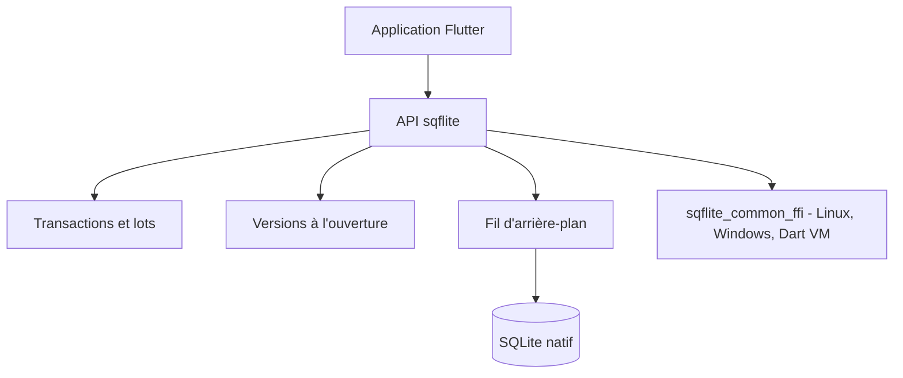

# tekartik/sqflite

> Plugin SQLite pour applications Flutter sur iOS, Android et macOS.

## Le problème
Une application Flutter qui garde ses données en local a besoin d'un accès SQLite natif depuis Dart.

## Ce que ça fait vraiment
Le plugin gère transactions et lots, la gestion automatique de version à l'ouverture et des aides pour insérer, lire, mettre à jour et supprimer. Les opérations tournent dans un fil d'arrière-plan sur iOS et Android. Linux, Windows et Dart VM passent par `sqflite_common_ffi`. Le README fait quelques lignes : le reste est dans la documentation externe.

## Comment c'est branché
Schéma simplifié d'après la fiche, sans diagramme fourni.

## Essayer
Aucune commande documentée dans le README (liens vers documentation, référence d'API et guide).

## Coût et pièges
Gratuit. Matière insuffisante : installation et exemples ne sont pas dans le README, il faut ouvrir la documentation externe.

## Ce que ce n'est pas
Ce n'est pas un ORM ni une solution de synchronisation : un accès SQLite avec quelques aides de requêtes. Il ne vise pas le web.

## Alternatives
Aucune alternative nommée dans le README.

## Pour toi
À ignorer : utile seulement pour du développement mobile Flutter, hors du périmètre data, IA ou MLOps.

