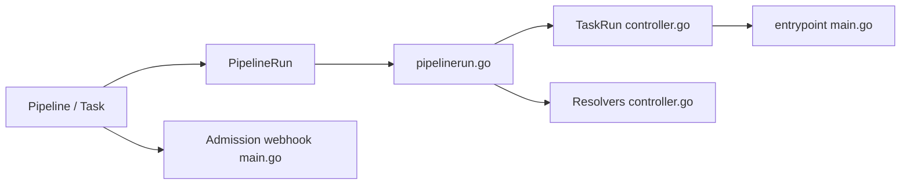

# tektoncd/pipeline

> Kubernetes resources to declare and run CI/CD pipelines in containers.

## The problem
CI/CD pipelines depend on a specific CI server; Tekton expresses them as portable Kubernetes resources.

## What it actually does
Defines `Task` and `Pipeline`; a `PipelineRun` is reconciled into `TaskRun`s by the controller, and Kubernetes launches the containers. Adds an admission webhook, API conversion, remote resolvers (Git...), cloud events and SPIRE identity.

## How it is wired

## Trying it
No command in the README: it points to the installation guide and the "Getting started" tutorial.

## Cost and gotchas
Free; requires a Kubernetes cluster whose minimum version rises with Tekton versions (1.28 for v0.61.x). v1alpha1, v1beta1, v1 migrations.

## What it is not
Not a turnkey CI server: a layer of resources to complete (triggers, interface), not described in this README.

## Alternatives
No alternative named in the README.

## For you
Worth watching: relevant if your ML pipelines already run on Kubernetes; otherwise too heavy.
