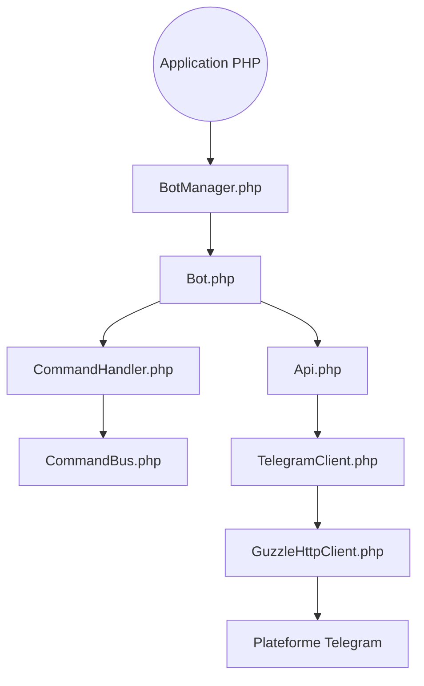

# telegram-bot-sdk/telegram-bot-sdk

> PHP library for writing Telegram bots, with a separate Laravel extension.

## The problem
Talking to Telegram's HTTP API by hand means writing requests, response parsing and command routing yourself.

## What it actually does
The SDK picks a configured bot, registers commands, turns updates into events and builds calls to the Telegram API. Requests go through an HTTP adapter (Guzzle). Telegram objects (keyboard, payment, files, stickers) are typed. Laravel support lives in the `telegram-bot-sdk/laravel` package.

## How it is wired
Diagram based on the code diagram.



## Trying it
```bash
composer require telegram-bot-sdk/telegram-bot-sdk
```
The only command described is the rename in `composer.json` (from `irazasyed/telegram-bot-sdk`); the package name above is deduced from it. The usage guide is on the documentation site, not reproduced in the README.

## Cost and gotchas
A Telegram bot token is required. PHP and Composer are required (not listed in the plan's prerequisites). The project was renamed at version 4: update `composer.json`.

## What it is not
Not a Telegram project: the README states it is neither affiliated with nor endorsed by Telegram. The README contains no code example, everything is on the docs site. Not a complete Laravel SDK: that part is a separate package.

## Alternatives
No alternative named in the README.

## For you
Keep an eye on it: useful only if you write a bot in PHP, otherwise outside your data / AI / MLOps stack.
