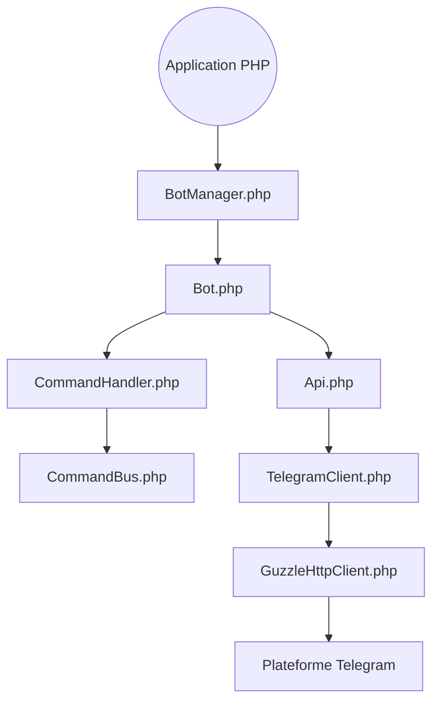

# telegram-bot-sdk/telegram-bot-sdk

> Bibliothèque PHP pour écrire des bots Telegram, avec une extension Laravel séparée.

## Le problème
Parler à l'API HTTP de Telegram à la main, c'est écrire requêtes, parsing des réponses et routage des commandes soi-même.

## Ce que ça fait vraiment
Le SDK choisit un bot configuré, enregistre des commandes, transforme les mises à jour en événements et construit les appels à l'API Telegram. Les requêtes passent par un adaptateur HTTP (Guzzle). Les objets Telegram (clavier, paiement, fichiers, stickers) sont typés. Le support Laravel vit dans le paquet `telegram-bot-sdk/laravel`.

## Comment c'est branché
Schéma d'après le diagramme du code.



## Essayer
```bash
composer require telegram-bot-sdk/telegram-bot-sdk
```
Seule commande décrite : le renommage dans `composer.json` (depuis `irazasyed/telegram-bot-sdk`) ; le nom du paquet ci-dessus s'en déduit. Le guide d'usage est sur le site de documentation, non reproduit dans le README.

## Coût et pièges
Il faut un jeton de bot Telegram. PHP et Composer sont requis (non listés dans les prérequis du plan). Le projet a changé de nom à la version 4 : mettre à jour `composer.json`.

## Ce que ce n'est pas
Pas un projet de Telegram : le README précise qu'il n'y est ni affilié ni approuvé. Le README ne contient aucun exemple de code, tout est dans le site de docs. Ce n'est pas un SDK Laravel complet : cette partie est un autre paquet.

## Alternatives
Aucune alternative nommée dans le README.

## Pour toi
Surveiller : utile seulement si tu écris un bot en PHP, sinon hors de ta pile data / IA / MLOps.

