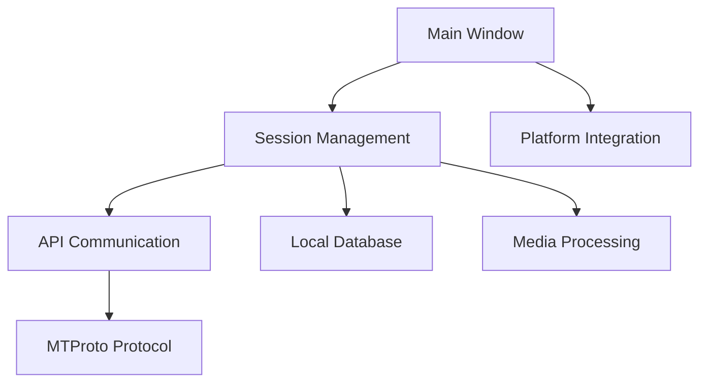

# telegramdesktop/tdesktop

> Source code of the official Telegram desktop client, for those who want to build or study it.

## The problem
Publishing the official client's code to allow auditing and building, based on the Telegram API and the MTProto protocol.

## What it actually does
The README describes almost nothing of the product: license (GPLv3 with OpenSSL exception), older versions for legacy systems, list of third-party libraries (Qt, OpenSSL, WebRTC, FFmpeg...) and build links for Windows, macOS, Linux via Docker. Architecture inferred from the code: UI, logic, storage, MTProto network, media and session layers.

## How it is wired

## Trying it
No command in the README: see `docs/building-win.md`, `docs/building-mac.md` and `docs/building-linux.md`.

## Cost and gotchas
Heavy build (Qt, many dependencies). Builds are documented per platform; the Linux build goes through Docker.

## What it is not
Not an SDK or a reusable library, and not a lightweight client. Nor is it the Telegram API, which is documented separately.

## Alternatives
No alternative cited in the README.

## For you
Ignore: only useful for studying a large Qt/C++ client; the GPL license requires reopening any derived code.
