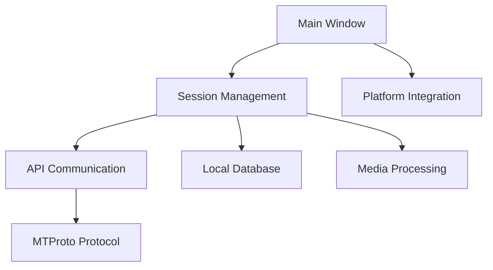

# telegramdesktop/tdesktop

> Code source du client Telegram de bureau officiel, pour qui veut le compiler ou l'étudier.

## Le problème
Publier le code du client officiel pour permettre l'audit et la compilation, à partir de l'API Telegram et du protocole MTProto.

## Ce que ça fait vraiment
Le README ne décrit presque rien du produit : licence (GPLv3 avec exception OpenSSL), anciennes versions pour systèmes anciens, liste des bibliothèques tierces (Qt, OpenSSL, WebRTC, FFmpeg…) et liens de compilation Windows, macOS, Linux via Docker. L'architecture déduite du code : couches UI, logique, stockage, réseau MTProto, médias, sessions.

## Comment c'est branché

## Essayer
Aucune commande dans le README : voir `docs/building-win.md`, `docs/building-mac.md` et `docs/building-linux.md`.

## Coût et pièges
Compilation lourde (Qt, nombreuses dépendances). Les builds sont documentés par plateforme ; la compilation Linux passe par Docker.

## Ce que ce n'est pas
Pas un SDK ni une bibliothèque réutilisable, et pas un client allégé. Ce n'est pas non plus l'API Telegram, qui est documentée à part.

## Alternatives
Aucune alternative citée dans le README.

## Pour toi
À ignorer : utile seulement pour étudier un gros client Qt/C++ ; la licence GPL oblige à rouvrir tout code dérivé.

