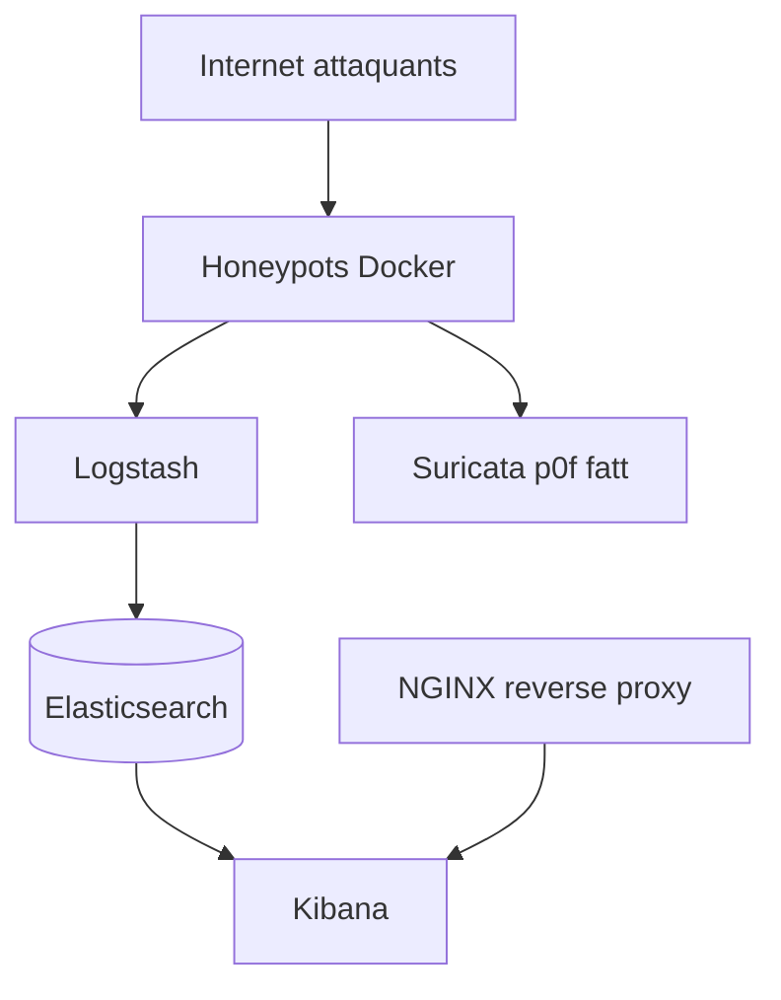

# telekom-security/tpotce

> Multi-honeypot platform with Elastic Stack and an attack map, for security teams.

## The problem
Observing real attacks requires deploying and wiring together many honeypots and visualization tools by hand.

## What it actually does
More than twenty honeypots (cowrie, dionaea, conpot, honeytrap, glutton...) run in Docker containers via docker compose, with Elasticsearch, Logstash, Kibana, an animated attack map, CyberChef, Spiderfoot, Suricata, p0f and fatt. Hive or distributed sensor mode, and LLM honeypots (Beelzebub, Galah) via Ollama.

## How it is wired


## Trying it
```bash
env bash -c "$(curl -sL https://github.com/telekom-security/tpotce/raw/master/install.sh)"
```

## Cost and gotchas
8 to 16 GB of RAM and 128 to 256 GB of disk. LLM honeypots require Ollama with a GPU. By default, data is sent to Sicherheitstacho (can be disabled). The README was truncated when read: the rest was not seen.

## What it is not
Not a tool to run on a workstation: it is deployed on a dedicated machine and can be compromised. No graphical environment.

## Alternatives
No alternative named in the README.

## For you
Keep an eye on it: interesting for generating attack datasets, but heavy to operate and outside the data/AI core.
