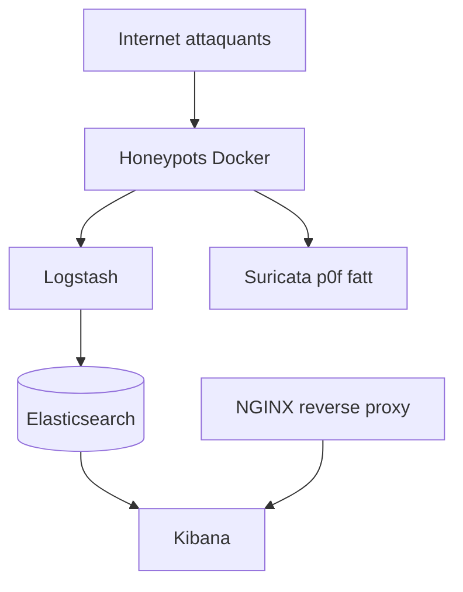

# telekom-security/tpotce

> Plateforme de honeypots multiples avec Elastic Stack et carte d'attaques, pour équipes sécurité.

## Le problème
Observer les attaques réelles demande de déployer et de relier à la main de nombreux honeypots et outils de visualisation.

## Ce que ça fait vraiment
Plus de vingt honeypots (cowrie, dionaea, conpot, honeytrap, glutton…) tournent en conteneurs Docker via docker compose, avec Elasticsearch, Logstash, Kibana, une carte d'attaques animée, CyberChef, Spiderfoot, Suricata, p0f et fatt. Mode hive ou sensor distribué, et honeypots à LLM (Beelzebub, Galah) via Ollama.

## Comment c'est branché


## Essayer
```bash
env bash -c "$(curl -sL https://github.com/telekom-security/tpotce/raw/master/install.sh)"
```

## Coût et pièges
8 à 16 Go de RAM et 128 à 256 Go de disque. Les honeypots LLM exigent Ollama avec GPU. Par défaut, les données partent vers Sicherheitstacho (désactivable). Le README était tronqué à la lecture : la suite n'a pas été vue.

## Ce que ce n'est pas
Pas un outil à lancer sur un poste de travail : il se déploie sur machine dédiée et peut être compromis. Pas d'environnement graphique.

## Alternatives
Aucune alternative nommée dans le README.

## Pour toi
À surveiller : intéressant pour générer des jeux de données d'attaques, mais lourd à exploiter et hors du cœur data/IA.

