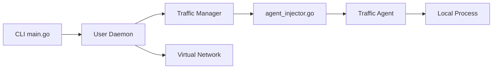

# telepresenceio/telepresence

> CNCF tool that connects your workstation to a Kubernetes cluster so you can develop locally.

## The problem
Every change to a service forces the build, push, deploy cycle before testing against the cluster's real traffic.

## What it actually does
A virtual network interface: the workstation resolves DNS and reaches the cluster's IPs.
Four modes: replace, intercept (filterable by header or path), wiretap, ingest.
A traffic-agent injected as a sidecar or as a node-agent (without restarting pods).
The local process runs with the environment and volumes of the remote container.

## How it is wired

## Trying it
No command documented in the README (it points to the Quick Start).

## Cost and gotchas
You need a Kubernetes cluster with the rights to deploy the traffic-manager.

## What it is not
Not a deployment or CI tool: nothing is delivered to the cluster, you only plug your workstation into it for the duration of development. And you need access to the cluster to inject its agent.

## Alternatives
No alternative named in the README.

## For you
Ignore, unless you develop microservices on Kubernetes daily: it is a platform developer tool, not a data one.
