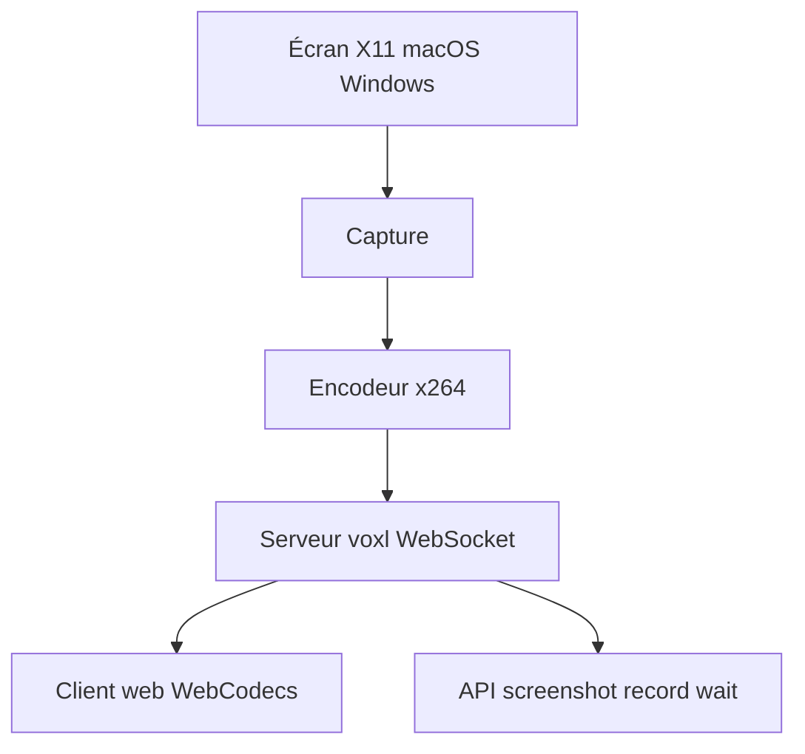

# tembo/voxl

> Rust server that streams an X11, Mac or Windows desktop as H.264 into a browser, with an API for agents.

## The problem
Viewing and controlling the desktop of a VM or sandbox without a GPU is slow with noVNC, which tops out at 6-8 frames per second.

## What it actually does
It captures the screen, encodes it as H.264 with x264 and sends it over a WebSocket to a small web client decoded with WebCodecs. It handles input, clipboard, audio, microphone, file transfer and dynamic resolution. `/screenshot`, `/record` and `/wait` routes are aimed at agents.

## How it is wired
Simplified diagram based on the fiche, no diagram provided.



## Trying it
```sh
cargo install voxl-server
DISPLAY=:1 voxl
curl -u ":$VOXL_PASSWORD" -o shot.png localhost:6901/screenshot
```

## Cost and gotchas
Free. Requires x264, libyuv, Opus, PulseAudio and esbuild. It serves plain HTTP: put it behind TLS outside localhost. No Wayland. Benchmarks are published by the author himself.

## What it is not
Not a replacement for Moonlight for gaming, nor for RustDesk for fixing machines remotely. On a lossy network, TCP can slow the frames.

## Alternatives
Sunshine with Moonlight for gaming on a GPU machine; RustDesk for accessing your own machines.

## For you
Worth watching: useful for giving a remote screen to computer-use type agents on GPU-less VMs, but the project is only a few months old.
