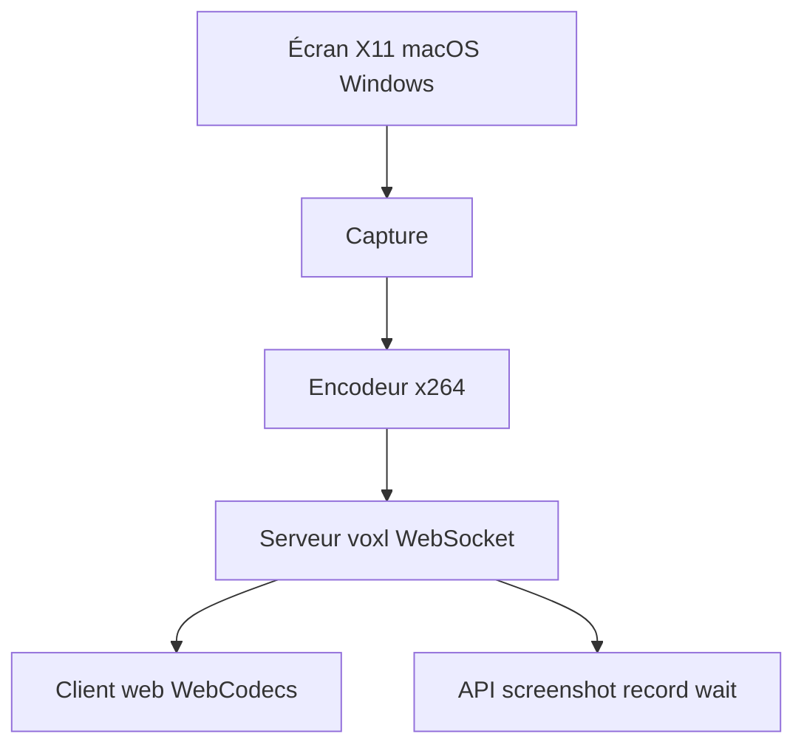

# tembo/voxl

> Serveur Rust qui diffuse un bureau X11, Mac ou Windows en H.264 dans un navigateur, avec API pour agents.

## Le problème
Voir et piloter un bureau de VM ou de bac à sable sans GPU est lent avec noVNC, qui plafonne à 6-8 images par seconde.

## Ce que ça fait vraiment
Il capture l'écran, l'encode en H.264 avec x264 et l'envoie par un WebSocket à un petit client web décodé par WebCodecs. Il gère entrée, presse-papiers, audio, micro, transfert de fichiers et résolution dynamique. Des routes `/screenshot`, `/record` et `/wait` s'adressent aux agents.

## Comment c'est branché
Schéma simplifié d'après la fiche, sans diagramme fourni.



## Essayer
```sh
cargo install voxl-server
DISPLAY=:1 voxl
curl -u ":$VOXL_PASSWORD" -o shot.png localhost:6901/screenshot
```

## Coût et pièges
Gratuit. Nécessite x264, libyuv, Opus, PulseAudio et esbuild. Il sert du HTTP simple : le placer derrière TLS hors localhost. Pas de Wayland. Benchmarks publiés par l'auteur lui-même.

## Ce que ce n'est pas
Pas un remplaçant de Moonlight pour jouer, ni de RustDesk pour dépanner des postes. Sur réseau avec pertes, TCP peut ralentir les images.

## Alternatives
Sunshine avec Moonlight pour jouer sur machine à GPU ; RustDesk pour accéder à ses propres machines.

## Pour toi
À surveiller : utile pour offrir un écran distant à des agents de type computer-use sur VM sans GPU, mais le projet a quelques mois.

