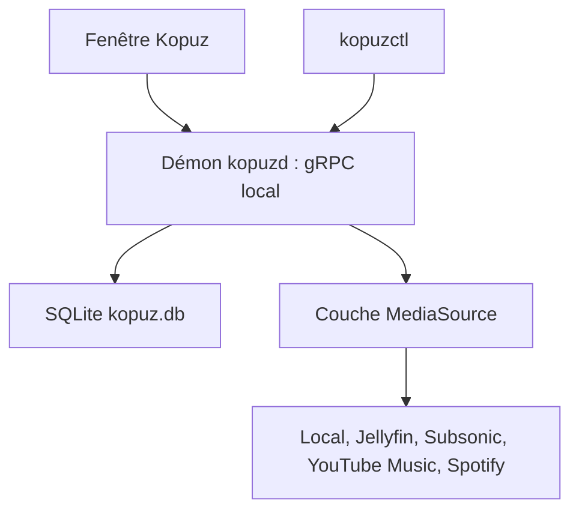

# temidaradev/kopuz

> Music player in Rust (GPUI/Dioxus) for local files, Jellyfin, Subsonic, YouTube Music and Spotify.

## The problem
Listening to your local library and several streaming services means juggling between applications.

## What it actually does
A daemon (`kopuzd`) manages the SQLite library, the audio engine and the sources; the window and `kopuzctl` are its clients, through a gRPC schema over a local socket. It plays audio CDs and SMB shares, and offers an equalizer, lyrics, ListenBrainz scrobbling, YouTube downloads and more than twenty languages. A "Legacy" Dioxus version remains.

## How it is wired
Simplified diagram based on the sheet, no diagram provided.


## Trying it
```bash
cargo install --locked kopuz
flatpak install flathub moe.kopuz.kopuz
nix run github:temidaradev/kopuz
```

## Cost and gotchas
Free; Spotify requires a Premium account and an app configuration. CD rips and conversions require ffmpeg and libcdio. EUPL-1.2 license: copyleft, to be read before any reuse.

## What it is not
Not a data or AI work tool. The streaming sources depend on third-party services (not guaranteed over time); the end of the provided README is truncated.

## Alternatives
No alternative named in the README.

## For you
Ignore: consumer music player, outside the data, AI and MLOps scope, under a copyleft license.
