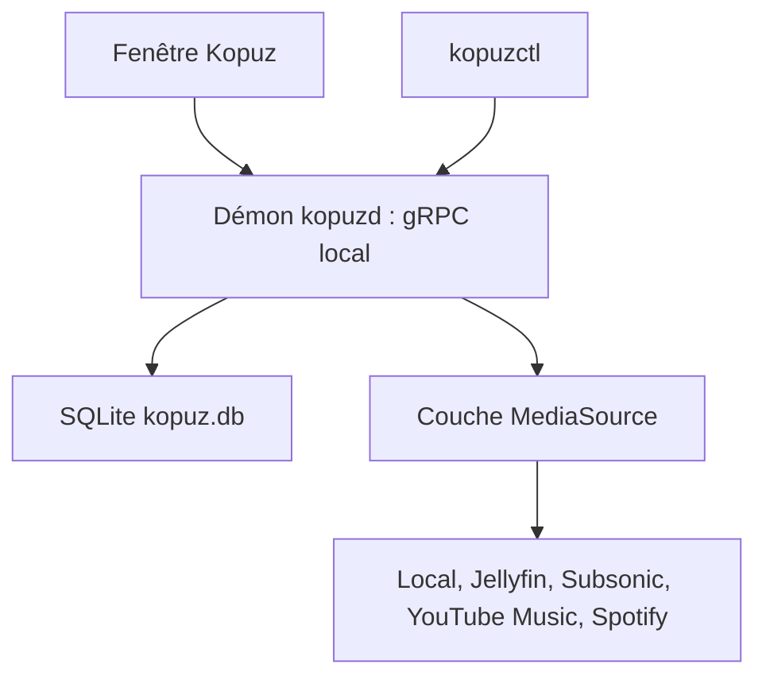

# temidaradev/kopuz

> Lecteur de musique en Rust (GPUI/Dioxus) pour fichiers locaux, Jellyfin, Subsonic, YouTube Music et Spotify.

## Le problème
Écouter sa bibliothèque locale et plusieurs services de streaming oblige à jongler entre applications.

## Ce que ça fait vraiment
Un démon (`kopuzd`) gère bibliothèque SQLite, moteur audio et sources ; la fenêtre et `kopuzctl` en sont des clients, via un schéma gRPC sur socket local. Il lit CD audio et partages SMB, propose égaliseur, paroles, scrobbling ListenBrainz, téléchargements YouTube et plus de vingt langues. Une version « Legacy » en Dioxus subsiste.

## Comment c'est branché
Schéma simplifié d'après la fiche, sans diagramme fourni.


## Essayer
```bash
cargo install --locked kopuz
flatpak install flathub moe.kopuz.kopuz
nix run github:temidaradev/kopuz
```

## Coût et pièges
Gratuit ; Spotify demande un compte Premium et une configuration d'application. Les rips de CD et les conversions exigent ffmpeg et libcdio. Licence EUPL-1.2 : copyleft à lire avant toute réutilisation.

## Ce que ce n'est pas
Pas un outil de travail data ou IA. Les sources de streaming dépendent de services tiers (non garanti dans le temps) ; la fin du README fourni est tronquée.

## Alternatives
Aucune alternative nommée dans le README.

## Pour toi
À ignorer : lecteur de musique grand public, hors périmètre data, IA et MLOps, sous licence copyleft.

