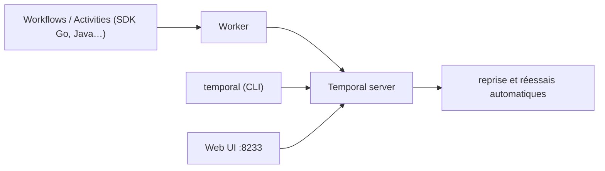

# temporalio/temporal

> Durable execution server: it replays workflows and retries failures for you.

## The problem
A long-running job that calls five external services breaks halfway through, and the recovery code —
state, retries, idempotence — ends up weighing more than the business logic.

## What it actually does
The server runs units of application logic called Workflows, handling intermittent failures itself and
relaunching failed operations. This repository contains the server's source code; Workflows, Activities
and Workers are written in one of the supported languages, through separate SDKs. A CLI (`temporal`)
queries the server, and a web UI is served on port 8233.
Temporal is a fork of Cadence, developed by Temporal Technologies.

## How it is wired


## Trying it
```bash
brew install temporal
temporal server start-dev
temporal operator namespace list
temporal workflow list
```

## Cost and gotchas
`start-dev` is a development mode: nothing in this README describes a production setup, nor storage,
nor sizing. The example sets differ between Go and Java, which the README states explicitly.

## What it is not
Not a library: this repository is the server, the application code lives in the SDKs. Not a cron task
scheduler nor a message queue — it is durable execution with replay.
Not documented here beyond the local start.

## Alternatives
- Cadence: Uber's project from which Temporal originates, named in the README.

## For you
The right foundation when a pipeline must survive failures; weigh it against a simple scheduler.
