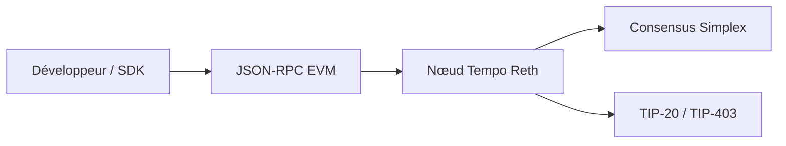

# tempoxyz/tempo

> Node for an EVM blockchain built for stablecoin payments, aimed at financial players and payment developers.

## The problem
General-purpose blockchains offer unpredictable fees and few compliance tools for stablecoin payments at large scale.

## What it actually does
An EVM-compatible client (Reth, targeting Osaka) with Simplex consensus (Commonware), a TIP-20 token standard, lanes reserved for transfers, memos, a compliance policy registry (TIP-403), fees paid in stablecoin, batched and sponsored transactions, and passkey authentication. Public testnet (Moderato); TypeScript, Rust, Go and Foundry SDKs.

## How it is wired


## Trying it
```bash
docker run --rm -p 127.0.0.1:8545:8545 ghcr.io/tempoxyz/tempo-localnet:latest
cast rpc tempo_fundAddress <ADDRESS> --rpc-url https://rpc.moderato.tempo.xyz
just build-all
cargo nextest run
```

## Cost and gotchas
Free on testnet. The README states that the audit is ongoing and that there is no active bug bounty: do not use with real money until the audits are finished.

## What it is not
Not a data science or AI tool. Privacy and on-chain exchange are "coming soon". The throughput figures come from the README.

## Alternatives
The README names no alternative, other than Ethereum, whose EVM it reuses.

## For you
Ignore: no link with data or AI; it only becomes useful if your product handles stablecoin payments.
