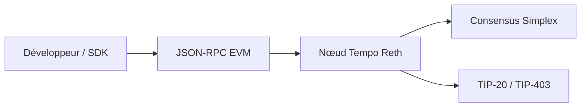

# tempoxyz/tempo

> Nœud d'une blockchain EVM pour paiements en stablecoins, destinée aux acteurs financiers et aux développeurs de paiement.

## Le problème
Les blockchains généralistes offrent des frais imprévisibles et peu d'outils de conformité pour des paiements en stablecoins à grande échelle.

## Ce que ça fait vraiment
Un client compatible EVM (Reth, visant Osaka) avec un consensus Simplex (Commonware), un standard de jetons TIP-20, des voies réservées aux transferts, des mémos, un registre de politiques de conformité (TIP-403), des frais en stablecoin, des transactions groupées et sponsorisées, et l'authentification par passkey. Testnet public (Moderato) ; SDK TypeScript, Rust, Go et Foundry.

## Comment c'est branché


## Essayer
```bash
docker run --rm -p 127.0.0.1:8545:8545 ghcr.io/tempoxyz/tempo-localnet:latest
cast rpc tempo_fundAddress <ADDRESS> --rpc-url https://rpc.moderato.tempo.xyz
just build-all
cargo nextest run
```

## Coût et pièges
Gratuit sur testnet. Le README précise que l'audit est en cours et qu'il n'y a pas de bug bounty actif : à ne pas utiliser avec de l'argent réel avant la fin des audits.

## Ce que ce n'est pas
Pas un outil de data science ni d'IA. Confidentialité et change on-chain sont « bientôt ». Les chiffres de débit viennent du README.

## Alternatives
Le README ne cite aucune alternative nommée, hors Ethereum, dont il reprend l'EVM.

## Pour toi
À ignorer : aucun lien avec les données ou l'IA ; il ne devient utile que si ton produit traite des paiements en stablecoins.

