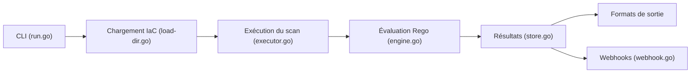

# tenable/terrascan

> Static infrastructure-as-code analyzer detecting misconfigurations and compliance violations; archived.

## The problem
Misconfigured cloud resources get deployed before anyone notices. They need to be spotted in the code, before provisioning.

## What it actually does
It analyzes Terraform (HCL2), CloudFormation, ARM, Kubernetes (YAML/JSON, Helm v3, Kustomize) and Dockerfiles with more than 500 policies written in Rego. It returns an exit code depending on violations and errors, in human-readable, JSON, YAML or XML formats. It can run as an API server (Kubernetes admission, webhooks) and attach image vulnerabilities from registries (ECR, ACR, GCR).

## How it is wired


## Trying it
```bash
brew install terrascan
terrascan scan
docker run tenable/terrascan
```

## Cost and gotchas
Free. Policies are downloaded on the first scan (or `terrascan init`). The repository is archived: no more fixes or new policies.

## What it is not
Not maintained: the README itself announces that no updates or PRs will be accepted. Not a continuous monitoring solution without integration effort.

## Alternatives
Not documented in the README: no alternative named.

## For you
Ignore for a new project: archiving means the rules will age; pick an IaC scanner that is still maintained for your MLOps pipelines.
