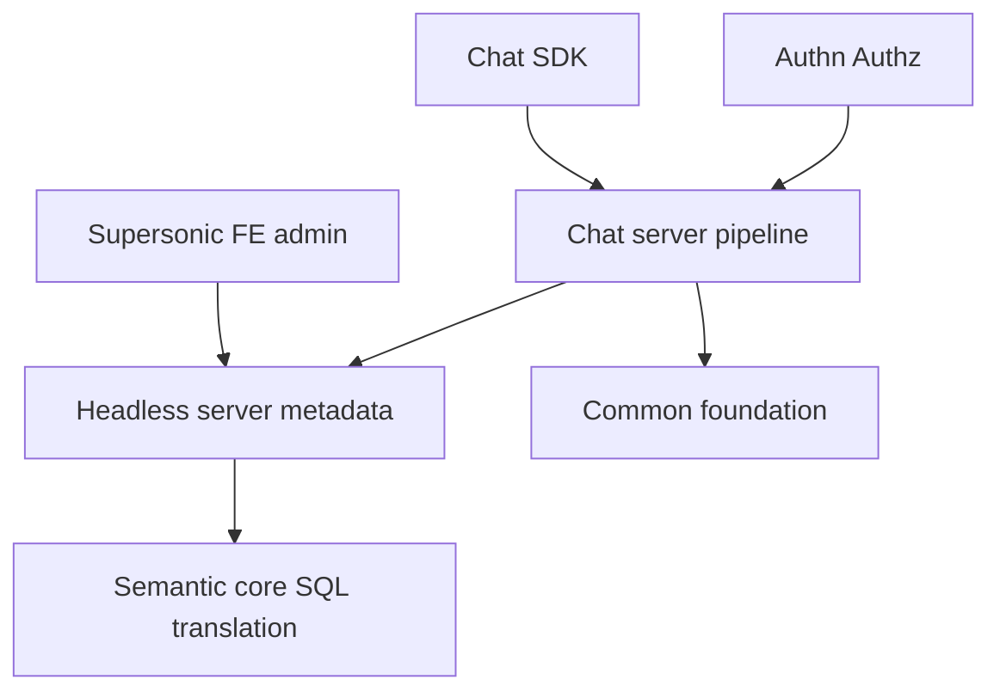

# tencentmusic/supersonic

> BI platform combining natural-language chat and a semantic layer to query data.

## The problem
Direct Text2SQL by an LLM is unreliable on real databases, because the model ignores business semantics.

## What it actually does
A Headless BI side defines metrics, dimensions and tags in a semantic model, translated into dialect-specific SQL (MySQL, Postgres, ClickHouse, Trino…). A Chat BI side maps the question onto this schema, analyzes it (rules or LLM), corrects it, translates it into SQL or sends it to a plugin, then displays charts. Access control by dataset, column and row.

## How it is wired


## Trying it
```bash
export SUPERSONIC_JWT_SECRET="$(openssl rand -hex 64)"
wget https://raw.githubusercontent.com/tencentmusic/supersonic/master/docker/docker-compose.yml
docker-compose up -d
# puis http://localhost:9080
```

## Cost and gotchas
A JWT secret is mandatory at startup. An LLM provider (OpenAI, Ollama, Dify…) is needed for Chat mode, with a possible bill. A license is present but not identified by GitHub. 334 open issues.

## What it is not
Not a ready-made solution without modeling: you must first build the semantic models. The public demo is reset every weekend.

## Alternatives
No alternative named in the README.

## For you
Worth watching: a serious approach to making Text2SQL reliable through a semantic layer, to be tested on a real case after checking the license.
