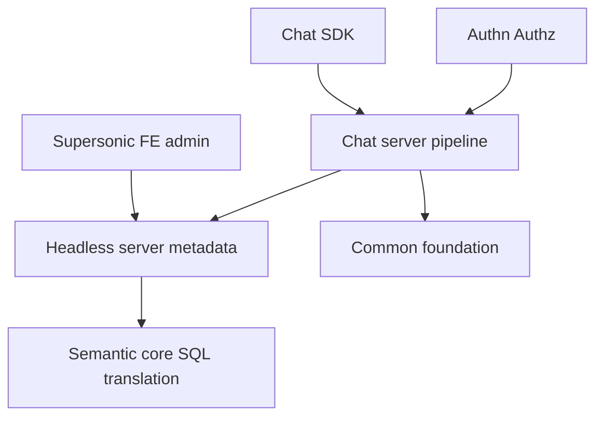

# tencentmusic/supersonic

> Plateforme BI qui combine chat en langage naturel et couche sémantique pour interroger des données.

## Le problème
Le Text2SQL direct par LLM est peu fiable sur de vraies bases, car le modèle ignore la sémantique métier.

## Ce que ça fait vraiment
Un côté Headless BI définit métriques, dimensions et tags dans un modèle sémantique, traduit en SQL adapté au dialecte (MySQL, Postgres, ClickHouse, Trino…). Un côté Chat BI mappe la question sur ce schéma, l'analyse (règles ou LLM), la corrige, la traduit en SQL ou l'envoie à un plugin, puis affiche des graphiques. Contrôle d'accès par jeu de données, colonne et ligne.

## Comment c'est branché


## Essayer
```bash
export SUPERSONIC_JWT_SECRET="$(openssl rand -hex 64)"
wget https://raw.githubusercontent.com/tencentmusic/supersonic/master/docker/docker-compose.yml
docker-compose up -d
# puis http://localhost:9080
```

## Coût et pièges
Un secret JWT est obligatoire au démarrage. Un fournisseur de LLM (OpenAI, Ollama, Dify…) est nécessaire pour le mode Chat, avec facture éventuelle. Licence présente mais non identifiée par GitHub. 334 issues ouvertes.

## Ce que ce n'est pas
Pas une solution prête sans modélisation : il faut d'abord construire les modèles sémantiques. Le démonstrateur public est réinitialisé chaque week-end.

## Alternatives
Aucune alternative nommée dans le README.

## Pour toi
À surveiller : approche sérieuse pour fiabiliser le Text2SQL via une couche sémantique, à tester sur un cas réel après vérification de la licence.

