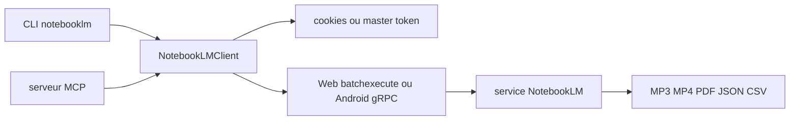

# teng-lin/notebooklm-py

> Unofficial Python API and CLI to drive NotebookLM (Gemini Notebook) from a script or an agent.

## The problem
NotebookLM reads and synthesizes your sources, but everything goes through clicks in a browser.
Impossible to load 30 documents into it, pull artifacts out in bulk, or hook it up to an agent.

## What it actually does
Covers notebooks, sources (URL, YouTube, PDF, Drive), cited chat, notes, labels, search and sharing.
Generates MP3 podcasts, MP4 videos, PDF/PPTX decks, quizzes, flashcards, infographics, CSV tables, JSON mind maps.
Exposes four surfaces: asynchronous Python API, CLI, MCP server (stdio or remote HTTP), local REST server.
Three authentication modes: interactive Playwright, cookies from an already logged-in browser, or a durable master token.

## How it is wired


## Trying it
```bash
uv tool install "notebooklm-py[browser]"
notebooklm login
notebooklm auth check --test --json
notebooklm create "My Research"
notebooklm source add "./paper.pdf"
notebooklm ask "What are the key themes?"
notebooklm generate audio "make it engaging" --wait
```

## Cost and gotchas
The master token is a full and durable account credential: the README recommends a dedicated account.
Source and notebook limits depend on your Google tier; heavy use may be throttled.

## What it is not
Not a Google product: it relies on undocumented internal APIs that can break without notice.
Not a tool for production: the README reserves it for prototypes, research and personal projects.
Not a local engine: all the synthesis happens at Google, your corpus goes to them.

## Alternatives
None named in the README.

## For you
Clever for offloading the reading of large corpora outside your token budget, provided you accept the risk of breakage.
