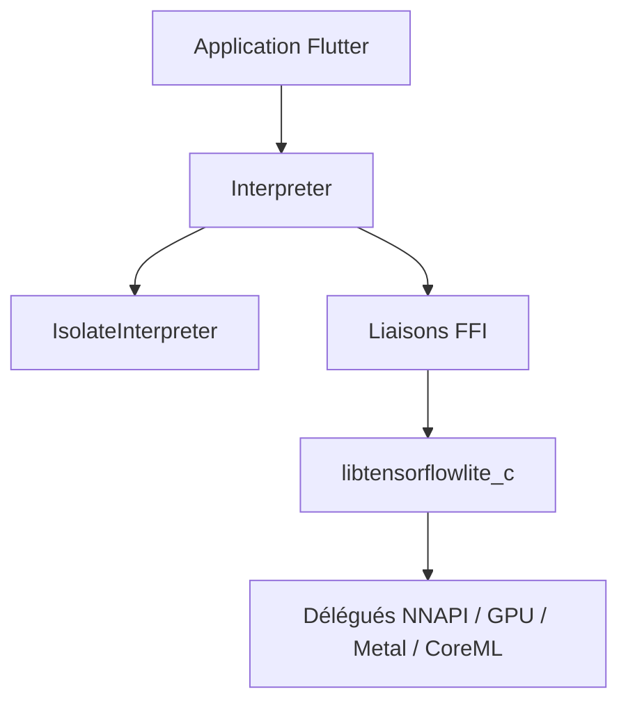

# tensorflow/flutter-tflite

> Flutter plugin to run TensorFlow Lite models on mobile and desktop through the TFLite C API.

## The problem
Running TFLite inference in a Flutter application requires a direct link to the native library.

## What it actually does
Binds the TFLite C API through FFI. Loads a model from an asset, a file or a buffer, runs `run` or `runForMultipleInputs`, and provides `IsolateInterpreter` so the interface is not blocked. Acceleration via NNAPI, GPU, Metal, CoreML and XNNPack.

## How it is wired
Simplified diagram based on the sheet, no diagram provided.



## Trying it
```dart
final interpreter = await Interpreter.fromAsset('assets/your_model.tflite');
interpreter.run(input, output);
interpreter.close();
```
Dependency: `tflite_flutter: ^0.10.1` in `pubspec.yaml`.

## Cost and gotchas
On macOS, Linux and Windows, the dynamic library must be built and added by hand. Android 26 minimum; testing on a real device is advised for iOS. Last push in October 2025, i.e. more than a year ago.

## What it is not
Not a training tool. The helper library is deprecated. The project says it is being updated.

## Alternatives
None cited in the README.

## For you
Ignore: barely active for more than a year and limited to Flutter, outside the day-to-day of a data / AI profile.
