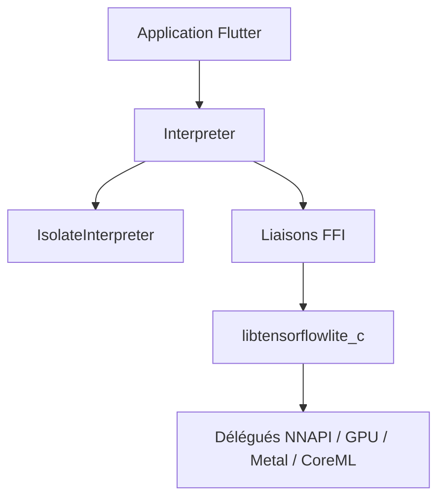

# tensorflow/flutter-tflite

> Plugin Flutter pour exécuter des modèles TensorFlow Lite sur mobile et bureau via l'API C de TFLite.

## Le problème
Faire de l'inférence TFLite dans une application Flutter demande un lien direct avec la bibliothèque native.

## Ce que ça fait vraiment
Lie l'API C de TFLite par FFI. Charge un modèle depuis un asset, un fichier ou un tampon, exécute `run` ou `runForMultipleInputs`, et offre `IsolateInterpreter` pour ne pas bloquer l'interface. Accélérations NNAPI, GPU, Metal, CoreML et XNNPack.

## Comment c'est branché
Schéma simplifié d'après la fiche, sans diagramme fourni.



## Essayer
```dart
final interpreter = await Interpreter.fromAsset('assets/your_model.tflite');
interpreter.run(input, output);
interpreter.close();
```
Dépendance : `tflite_flutter: ^0.10.1` dans `pubspec.yaml`.

## Coût et pièges
Sur macOS, Linux et Windows, la bibliothèque dynamique est à compiler et à ajouter à la main. Android 26 minimum ; test sur appareil réel conseillé pour iOS. Dernier push en octobre 2025, soit plus d'un an.

## Ce que ce n'est pas
Pas un outil d'entraînement. La bibliothèque d'aide (helper) est dépréciée. Le projet se dit en cours de mise à jour.

## Alternatives
Aucune citée dans le README.

## Pour toi
Ignorer : peu actif depuis plus d'un an et limité à Flutter, hors du quotidien d'un profil data / IA.

