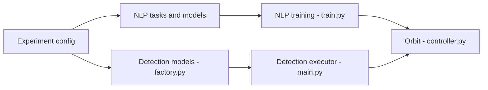

# tensorflow/models

> Collection of TensorFlow 2 model implementations (official and research), and the Orbit library, for TensorFlow users.

## The problem
Find well-maintained, state-of-the-art reference implementations of TensorFlow models, along with a reusable training loop.

## What it actually does
Four directories: `official` (TF2 models maintained by the team), `research` (research code, TF1 or 2), `community` (list of repositories), and `orbit` (custom training loops compatible with `tf.distribute`, CPU/GPU/TPU). The graph shows NLP, vision/detection, recommendation, Triton inference, and BigQuery.

## How it is wired


## Trying it
```bash
pip3 install tf-models-official
pip3 install tf-models-nightly
git clone https://github.com/tensorflow/models.git
export PYTHONPATH=$PYTHONPATH:/path/to/models
pip3 install --user -r models/official/requirements.txt
```

## Cost and gotchas
Free; a GPU/TPU is recommended for training. The stable package may be behind the `master` version; the nightly build corrects this, but it changes daily. For NLP, `tensorflow-text-nightly` is also required.

## What it is not
This is not a collection of pre-trained models that can be downloaded: it is implementation code. The `research` directory is maintained by researchers, and there is no guarantee of updates.

## Alternatives
No alternative is specified in the README file.

## For you
Things to watch out for: This is relevant if your stack includes TensorFlow (Orbit, vision), but the industry trend is moving towards PyTorch, and the licensing needs to be confirmed.
