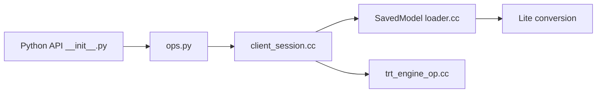

# tensorflow/tensorflow

> Open-source machine learning platform, developed by Google Brain, for researchers and engineers.

## The problem
Training and deploying neural networks on CPUs, GPUs, and embedded devices requires a common foundation for tensor computation, gradient calculation, and export.

## What it actually does
Stable Python and C++ APIs, with no guarantee of compatibility for other languages. The code demonstrates a C++ session that extends and executes the graph, distributed strategies, SavedModel and checkpoints, Lite conversion, TensorRT, and device plugins. Go and Java bindings are available. The CUDA GPU is managed under Ubuntu and Windows.

## How it is wired


## Trying it
```bash
pip install tensorflow
pip install tensorflow-cpu
python
>>> import tensorflow as tf
>>> tf.add(1, 2).numpy()
```

## Cost and gotchas
Free. The GPU requires CUDA; other accelerators use plugins. APIs that are not Python-based do not have compatibility guarantees.

## What it is not
Not a ready-made solution: it's a basic framework, without any tracking or coordination. It's not the only option available, and no competitors are mentioned.

## Alternatives
No alternative is specified in the README file.

## For you
This document is more of a reference guide for existing systems and for mobile deployment, rather than a guide for implementing new features. It mainly covers installation, but doesn't provide any additional information.
