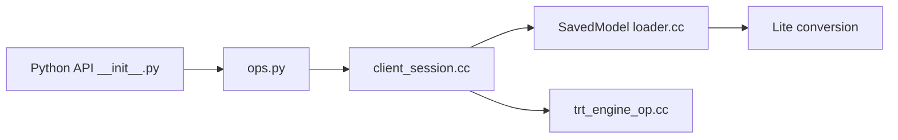

# tensorflow/tensorflow

> Plateforme open source de machine learning de bout en bout, issue de Google Brain, pour chercheurs et ingénieurs.

## Le problème
Entraîner et déployer des réseaux de neurones sur CPU, GPU et appareils embarqués exige un socle commun de calcul tensoriel, de gradients et d'export.

## Ce que ça fait vraiment
API Python et C++ stables, autres langages sans garantie de compatibilité. Le code montre une session C++ qui étend et exécute le graphe, des stratégies distribuées, SavedModel et points de contrôle, la conversion Lite, TensorRT et des plugins de périphériques. Des liaisons Go et Java existent. Le GPU CUDA est géré sous Ubuntu et Windows.

## Comment c'est branché


## Essayer
```bash
pip install tensorflow
pip install tensorflow-cpu
python
>>> import tensorflow as tf
>>> tf.add(1, 2).numpy()
```

## Coût et pièges
Gratuit. Le GPU demande CUDA ; les autres accélérateurs passent par des plugins. Les API non Python n'ont pas de garantie de compatibilité.

## Ce que ce n'est pas
Pas un outil clé en main : c'est un socle, sans suivi d'expériences ni orchestration. Pas seul sur le marché, aucun concurrent n'est nommé.

## Alternatives
Aucune alternative nommée dans le README.

## Pour toi
À surveiller plutôt qu'à adopter pour du neuf : référence dans l'existant et pour le déploiement mobile, mais ce README ne dit rien de plus que l'installation.

