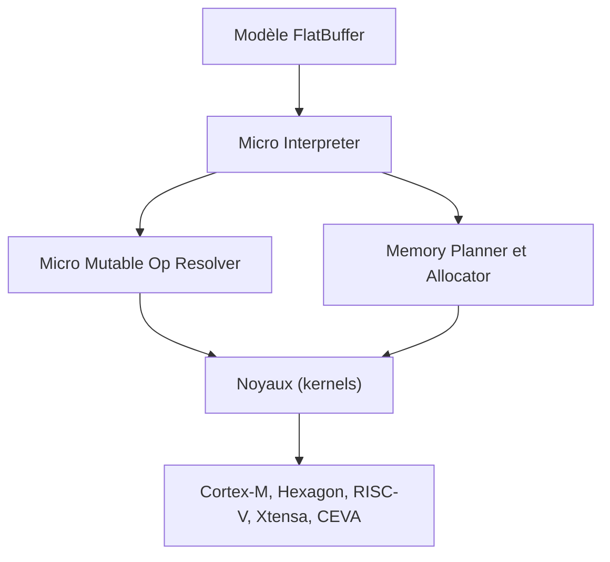

# tensorflow/tflite-micro

> TensorFlow Lite inference engine for microcontrollers and DSPs, aimed at embedded AI engineers.

## The problem
Running a model on hardware with a few tens or hundreds of kilobytes of memory and no operating system.

## What it actually does
The README is very short: it presents the project and a list of documents. According to the architecture deduced from the code, a FlatBuffer model is read by an interpreter; an operator resolver chooses the kernels; a memory planner preallocates the tensors. Optimized kernels exist for Cortex-M, Hexagon, RISC-V, Xtensa and CEVA.

## How it is wired

## Trying it
No command documented in the README; see the listed guides (memory, porting, compression tool, Python interpreter).

## Cost and gotchas
Free. The model must be converted beforehand with LiteRT or TensorFlow. The build relies on Bazel.

## What it is not
Not a training framework nor a runtime for servers or phones. The README gives neither an example nor a quick start.

## Alternatives
Not documented in the README.

## For you
Worth watching: the reference for microcontroller inference if your MLOps project targets embedded, of no interest for cloud deployment.
