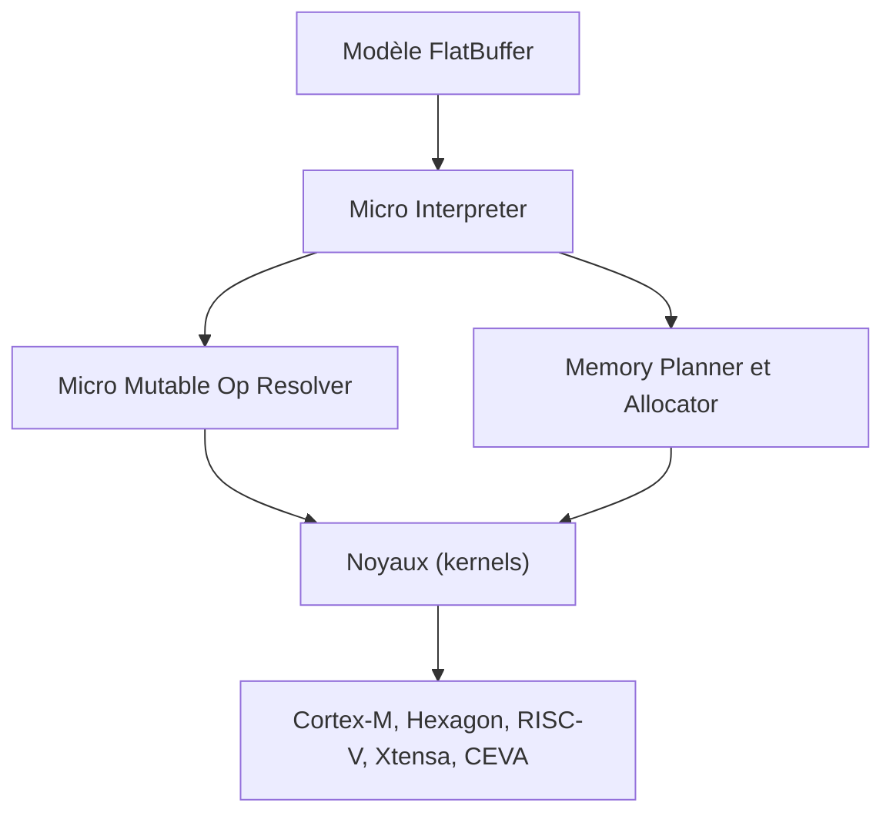

# tensorflow/tflite-micro

> Moteur d'inférence TensorFlow Lite pour microcontrôleurs et DSP, destiné aux ingénieurs de l'IA embarquée.

## Le problème
Faire tourner un modèle sur du matériel avec quelques dizaines ou centaines de kilo-octets de mémoire sans système d'exploitation.

## Ce que ça fait vraiment
Le README est très court : il présente le projet et une liste de documents. D'après l'architecture déduite du code, un modèle FlatBuffer est lu par un interpréteur ; un résolveur d'opérateurs choisit les noyaux ; un planificateur de mémoire préalloue les tenseurs. Des noyaux optimisés existent pour Cortex-M, Hexagon, RISC-V, Xtensa et CEVA.

## Comment c'est branché

## Essayer
Aucune commande documentée dans le README ; voir les guides listés (mémoire, portage, outil de compression, interpréteur Python).

## Coût et pièges
Gratuit. Le modèle doit être converti au préalable avec LiteRT ou TensorFlow. Le build s'appuie sur Bazel.

## Ce que ce n'est pas
Pas un cadre d'entraînement ni un runtime pour serveurs ou téléphones. Le README ne donne ni exemple ni démarrage rapide.

## Alternatives
Non documenté dans le README.

## Pour toi
À surveiller : la référence de l'inférence sur microcontrôleur si ton projet MLOps cible de l'embarqué, sans intérêt pour du déploiement cloud.

