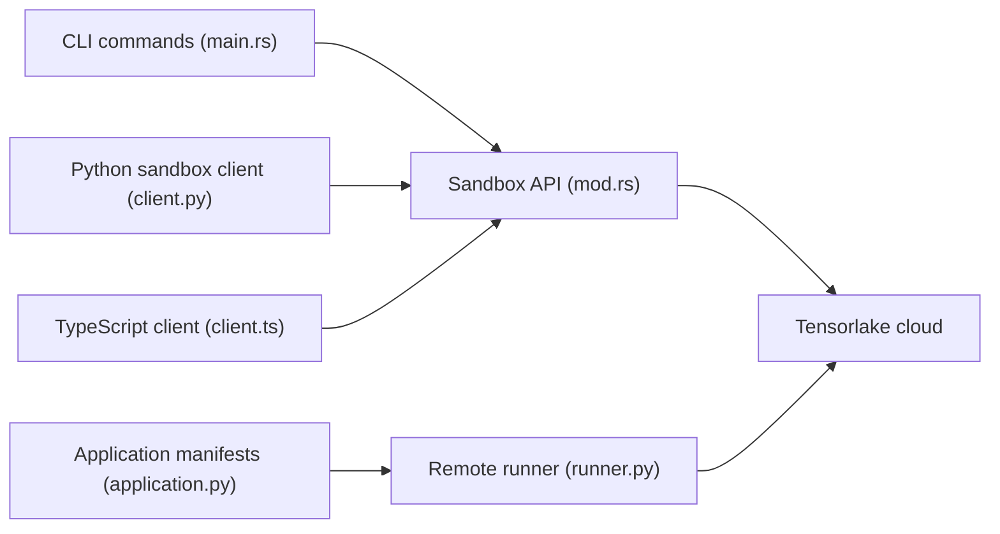

# tensorlakeai/tensorlake

> Cloud platform of microVM sandboxes and serverless orchestration for agents that run generated code.

## The problem
Running LLM-produced code without isolating it exposes your infrastructure; you also need to be able to pause and resume an agent's state.

## What it actually does
Python, TypeScript and Rust SDKs and a `tl` CLI to create Firecracker sandboxes, run commands in them, copy files, snapshot, pool and restrict the network. Adds versioned cloud volumes and an application runtime (@application, @function) deployed with `tl deploy`. The benchmark figures come from the README and are not verified.

## How it is wired


## Trying it
```bash
pip install tensorlake
curl -fsSL https://tensorlake.ai/install | sh
export TENSORLAKE_API_KEY="your-api-key"
tl login
tl sbx create
```

## Cost and gotchas
Account and key required on cloud.tensorlake.ai; pricing not specified in the README. Images are limited to registered Sandbox Images (no arbitrary Docker image). The execution code runs on their side.

## What it is not
Not a local or self-hostable runtime according to the README. The SDK is open, but the platform is a hosted service.

## Alternatives
E2B, Modal, Daytona and Vercel, cited in the README as a performance comparison.

## For you
Worth watching: relevant for running agent code safely, but depends on a SaaS and the benchmarks are supplied by the vendor.
