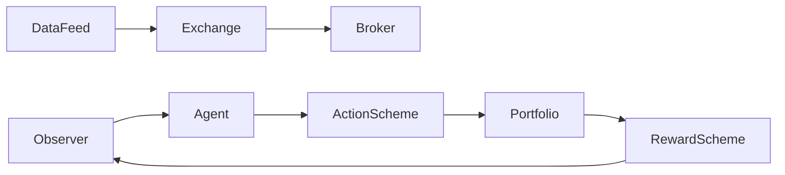

# tensortrade-org/tensortrade

> Python framework for training and evaluating reinforcement learning agents in trading.

## The problem
Building a realistic RL trading environment (orders, portfolio, commissions, rewards) takes time and often produces biased results.

## What it actually does
Provides a composable `TradingEnv`: Observer, ActionScheme (BSH), RewardScheme (PBR), Portfolio, simulated Exchange with configurable commission.
Training scripts with Ray RLlib and Optuna optimization.
The README honestly publishes its results: a PPO on BTC/USD beats buy-and-hold at 0% commission, and loses at 0.1%.
Tutorials on overfitting and walk-forward validation.

## How it is wired


## Trying it
```bash
python3.12 -m venv tensortrade-env && source tensortrade-env/bin/activate
pip install -e .
pip install -r examples/requirements.txt
python examples/training/train_simple.py
pytest tests/tensortrade/unit -v
```

## Cost and gotchas
Free; Python 3.11/3.12. RLlib training is CPU-hungry.
The results show that commissions wipe out the gain: a classic backtesting trap.

## What it is not
Not a trading bot ready to make money.
Not a production broker connector documented in the README.

## Alternatives
No alternative named in the README.

## For you
Worth watching: a good ground for learning applied RL with honest results, but no direct production value.
