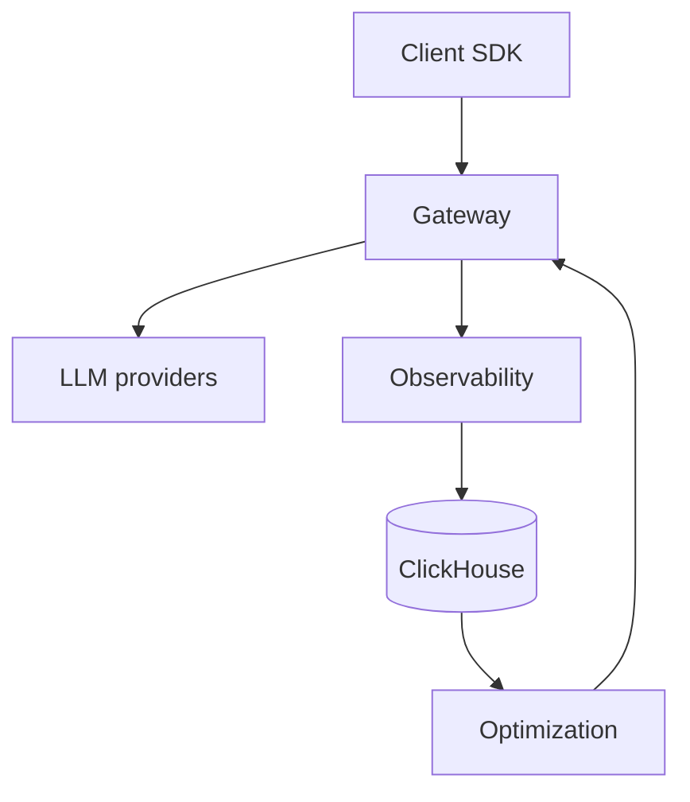

# tensorzero/tensorzero

> Open-source LLMOps platform: gateway, observability, evaluation, optimization and experimentation.

## The problem
Taking an LLM application from prototype to production without stacking five separate tools.

## What it actually does
A Rust gateway (claimed overhead under 1 ms at p99) unifies providers behind an OpenAI-compatible API. It stores inferences and feedback in ClickHouse, with a UI to compare, evaluate (heuristics, LLM judges), optimize prompts (GEPA), fine-tune models and run A/B tests. It exports OpenTelemetry and Prometheus.

## How it is wired


## Trying it
```python
from openai import OpenAI
client = OpenAI(base_url="http://localhost:3000/openai/v1", api_key="not-used")
```
```bash
docker compose run --rm evaluations --evaluation-name extract_data --dataset-name hard_test_cases --variant-name gpt_4o --concurrency 5
```

## Cost and gotchas
The core is self-hosted and free; "Autopilot" is a complementary paid product. Provider keys are on you. Repository archived according to the catalog, while the README still speaks of an active project.

## What it is not
Not an agent framework nor a simple proxy. The usage figures (about 1% of LLM API spend) come from the authors and are not verified here.

## Alternatives
No alternative named in the README.

## For you
Watch: the gateway, evaluation and optimization architecture is a good MLOps reference, but the archiving rules out relying on it in production.
