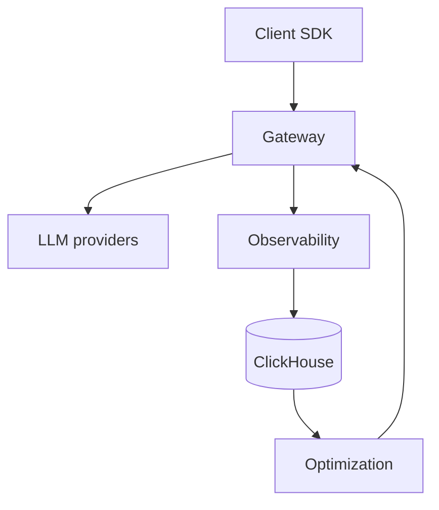

# tensorzero/tensorzero

> Plateforme LLMOps open source : passerelle, observabilité, évaluation, optimisation et expérimentation.

## Le problème
Faire passer une application LLM du prototype à la production sans empiler cinq outils séparés.

## Ce que ça fait vraiment
Une passerelle en Rust (surcoût annoncé sous 1 ms au p99) unifie les fournisseurs derrière une API compatible OpenAI. Elle stocke inférences et retours dans ClickHouse, avec une interface pour comparer, évaluer (heuristiques, juges LLM), optimiser des prompts (GEPA), affiner des modèles et lancer des tests A/B. Elle exporte OpenTelemetry et Prometheus.

## Comment c'est branché


## Essayer
```python
from openai import OpenAI
client = OpenAI(base_url="http://localhost:3000/openai/v1", api_key="not-used")
```
```bash
docker compose run --rm evaluations --evaluation-name extract_data --dataset-name hard_test_cases --variant-name gpt_4o --concurrency 5
```

## Coût et pièges
Le cœur est auto-hébergé et gratuit ; « Autopilot » est un produit payant complémentaire. Clés des fournisseurs à ta charge. Dépôt archivé selon le catalogue, alors que le README parle encore d'un projet actif.

## Ce que ce n'est pas
Pas un framework d'agents ni un simple proxy. Les chiffres d'usage (environ 1 % des dépenses d'API LLM) viennent des auteurs et ne sont pas vérifiés ici.

## Alternatives
Aucune alternative nommée dans le README.

## Pour toi
À surveiller : l'architecture passerelle, évaluation et optimisation est une bonne référence MLOps, mais l'archivage interdit de s'y appuyer en production.

