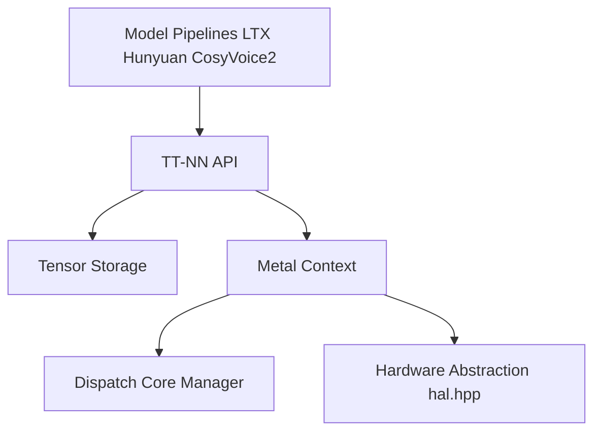

# tenstorrent/tt-metal

> Tenstorrent software stack: TT-NN operator library and TT-Metalium low-level programming model.

## The problem
Running and optimizing neural networks on Tenstorrent accelerators (Wormhole, Blackhole), which lack the CUDA ecosystem.

## What it actually does
TT-NN provides neural network operators in Python and C++; TT-Metalium lets you write kernels for the hardware. The README gives LLM performance figures (Llama 3.3 70B, Qwen 2.5, Mixtral, Whisper), technical reports, kernel examples and tools (visualizer, TT-SMI, Tracy profiler, Watcher). The repository takes part in a bounty program. The README mentions vLLM through a dedicated plugin; the old fork is deprecated.

## How it is wired


## Trying it
```bash
# Aucune commande dans le README : voir les pages Install et Getting started.
```

## Cost and gotchas
Requires Tenstorrent hardware. 6,956 open issues. The version table is partly outdated.

## What it is not
Not a general-purpose framework: it serves only Tenstorrent cards. The performance figures come from the repository's demos.

## Alternatives
No alternative named in the README (TT-Forge, TT-Torch, TT-XLA are neighboring Tenstorrent projects).

## For you
Worth watching: relevant only if you are evaluating inference hardware alternative to NVIDIA, otherwise out of reach.
