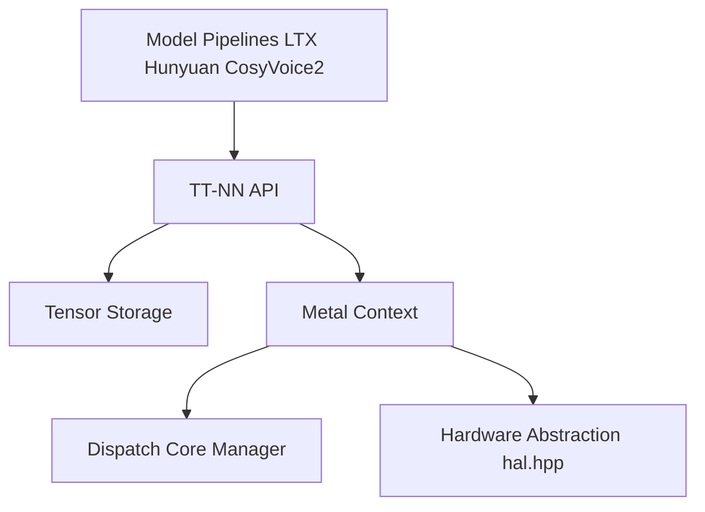

# tenstorrent/tt-metal

> Pile logicielle Tenstorrent : bibliothèque d'opérateurs TT-NN et modèle de programmation bas niveau TT-Metalium.

## Le problème
Exécuter et optimiser des réseaux de neurones sur les accélérateurs Tenstorrent (Wormhole, Blackhole), qui n'ont pas l'écosystème CUDA.

## Ce que ça fait vraiment
TT-NN fournit des opérateurs de réseaux de neurones en Python et C++ ; TT-Metalium permet d'écrire des kernels pour le matériel. Le README donne des performances de LLM (Llama 3.3 70B, Qwen 2.5, Mixtral, Whisper), des rapports techniques, des exemples de kernels et des outils (visualiseur, TT-SMI, profileur Tracy, Watcher). Le dépôt participe à un programme de primes. Le README parle de vLLM via un plugin dédié ; l'ancien fork est déprécié.

## Comment c'est branché


## Essayer
```bash
# Aucune commande dans le README : voir les pages Install et Getting started.
```

## Coût et pièges
Exige du matériel Tenstorrent. 6 956 issues ouvertes. Le tableau des versions est partiellement daté.

## Ce que ce n'est pas
Pas un framework généraliste : il sert uniquement les cartes Tenstorrent. Les chiffres de performance viennent des démos du dépôt.

## Alternatives
Aucune alternative nommée dans le README (TT-Forge, TT-Torch, TT-XLA sont des projets Tenstorrent voisins).

## Pour toi
À surveiller : pertinent seulement si tu évalues du matériel d'inférence alternatif à NVIDIA, sinon hors de portée.

