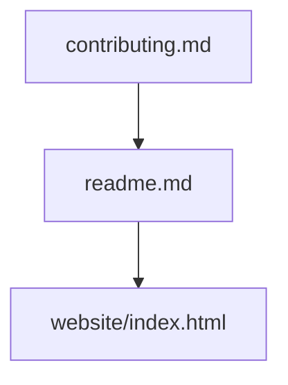

# terkelg/awesome-creative-coding

> Resource list for generative art and creative coding, for beginners and intermediates.

## The problem
Knowing where to start to create visuals and sounds with code.

## What it actually does
A `readme.md` file of links: books, courses, frameworks (Processing, openFrameworks, three.js, p5.js), visual and sound languages, shaders, hardware, communities, events, a machine learning and vision section. A `contributing.md` sets the rules and a `website/index.html` provides a web version.

## How it is wired

## Trying it
No documented command.

## Cost and gotchas
Free. No license declared. README truncated beyond the quick references section.

## What it is not
Not a tool. The ML section is one section among many, not the core.

## Alternatives
No alternative named in the README.

## For you
Ignore: mostly shaders and generative art, far from your data and AI needs.
