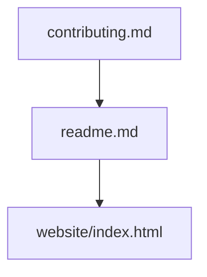

# terkelg/awesome-creative-coding

> Liste de ressources d'art génératif et de programmation créative, pour débutants et intermédiaires.

## Le problème
Savoir par où commencer pour créer des visuels et des sons par le code.

## Ce que ça fait vraiment
Un fichier `readme.md` de liens : livres, cours, frameworks (Processing, openFrameworks, three.js, p5.js), langages visuels et sonores, shaders, matériel, communautés, événements, une rubrique apprentissage automatique et vision. Un `contributing.md` fixe les règles et un `website/index.html` en donne une version web.

## Comment c'est branché

## Essayer
Aucune commande documentée.

## Coût et pièges
Gratuit. Aucune licence déclarée. README tronqué au-delà de la rubrique des références rapides.

## Ce que ce n'est pas
Ce n'est pas un outil. La rubrique ML est une section parmi beaucoup, pas le cœur.

## Alternatives
Aucune alternative nommée dans le README.

## Pour toi
À ignorer : surtout shaders et art génératif, loin de tes besoins data et IA.

