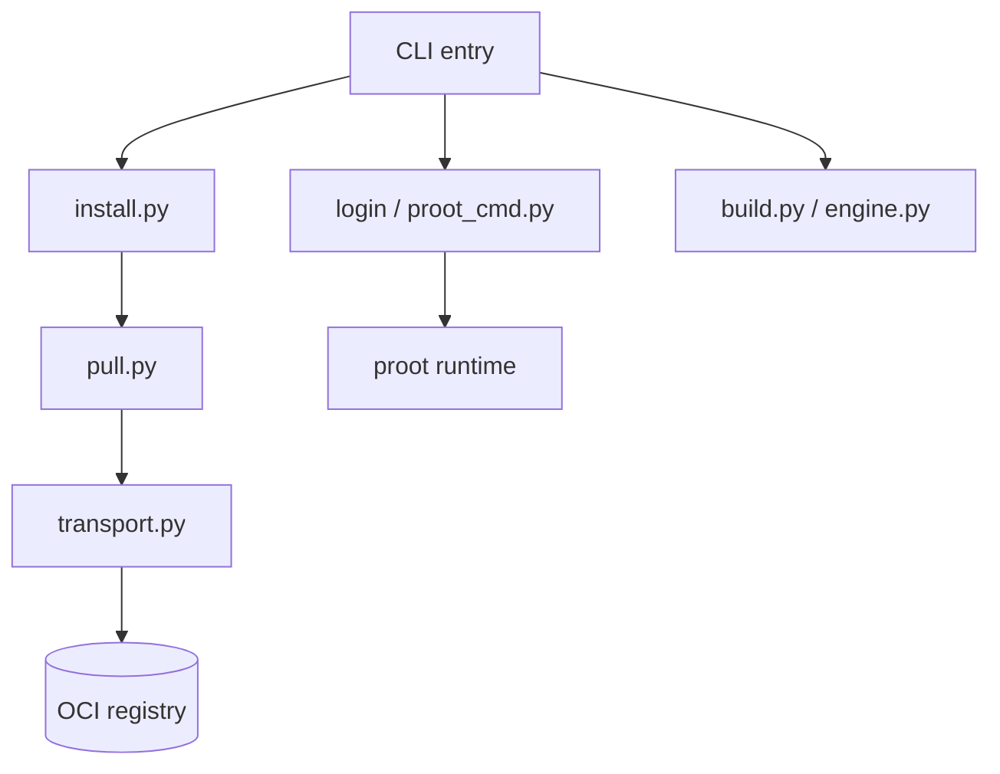

# termux/proot-distro

> Command-line tool that runs Linux containers without root, from Termux or an ordinary Linux.

## The problem
Running a Linux distribution on a phone or a host without root rights, with no Docker daemon or kernel module.

## What it actually does
Fetches Docker/OCI images from a registry or a local archive, assembles the filesystem and opens it through `proot`. Can also build an image from a Dockerfile and push it to a registry. Handles search, backup, restore and file transfer. `RUN` steps run under `proot`, with no process or network isolation.

## How it is wired


## Trying it
```bash
pkg install proot-distro
proot-distro install ubuntu:24.04
proot-distro login ubuntu
proot-distro build -t myapp:1.0 --install-as myapp ./mycontext
proot-distro remove ubuntu
```

## Cost and gotchas
Free. Python 3.9 or later and `proot` required. Private registries need `PD_DOCKER_AUTH`, and Docker Hub limits anonymous pulls.

## What it is not
Not a real container runtime: no cgroups, no seccomp, no PID or network isolation. No multi-architecture manifest lists. The README provided is truncated; the `login` command and the following ones were not all read.

## Alternatives
- Docker: a real runtime with isolation, but it needs a daemon and privileges.

## For you
Ignore: useful for an Android phone or a machine without root, outside the data / MLOps field where Docker is available.
