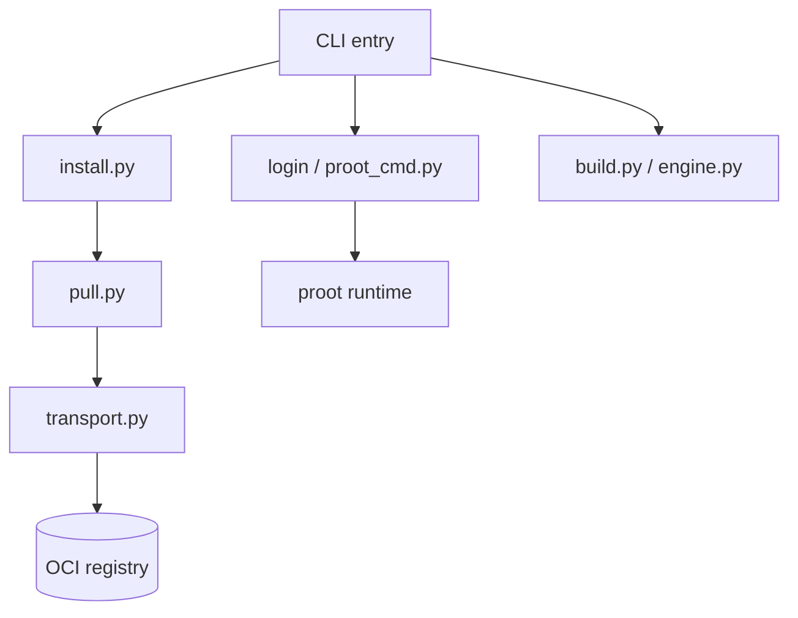

# termux/proot-distro

> Outil en ligne de commande qui lance des conteneurs Linux sans root, depuis Termux ou un Linux ordinaire.

## Le problème
Faire tourner une distribution Linux sur un téléphone ou un hôte sans droits root, sans démon Docker ni module noyau.

## Ce que ça fait vraiment
Récupère des images Docker/OCI depuis un registre ou une archive locale, assemble le système de fichiers et l'ouvre via `proot`. Peut aussi construire une image depuis un Dockerfile et la pousser vers un registre. Gère recherche, sauvegarde, restauration et transfert de fichiers. Les étapes `RUN` tournent sous `proot`, sans isolation de processus ni de réseau.

## Comment c'est branché


## Essayer
```bash
pkg install proot-distro
proot-distro install ubuntu:24.04
proot-distro login ubuntu
proot-distro build -t myapp:1.0 --install-as myapp ./mycontext
proot-distro remove ubuntu
```

## Coût et pièges
Gratuit. Python 3.9 ou plus et `proot` requis. Les registres privés demandent `PD_DOCKER_AUTH`, et Docker Hub limite les pulls anonymes.

## Ce que ce n'est pas
Pas un vrai runtime de conteneurs : ni cgroups, ni seccomp, ni isolation PID ou réseau. Pas de listes de manifestes multi-architecture. Le README fourni est tronqué, les commandes `login` et suivantes ne sont pas toutes lues.

## Alternatives
- Docker : vrai runtime avec isolation, mais il demande un démon et des droits.

## Pour toi
À ignorer : utile pour un téléphone Android ou une machine sans root, hors du terrain data / MLOps où Docker est disponible.

