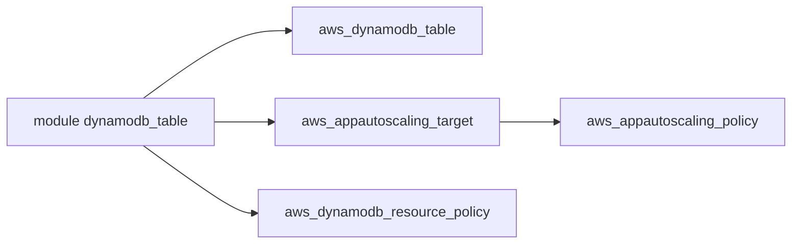

# terraform-aws-modules/terraform-aws-dynamodb-table

> Terraform module to create a DynamoDB table with autoscaling, indexes, replicas and backups.

## The problem
Declaring a complete DynamoDB table (indexes, capacity, TTL, encryption, PITR) as clean, reproducible code.

## What it actually does
Creates the table and, depending on the options, autoscaling policies, secondary indexes, streams, global replicas, import from S3, restore. Billing is PAY_PER_REQUEST by default. Warnings describe table recreations if you toggle autoscaling or `ignore_changes_global_secondary_index`.

## How it is wired


## Trying it
```bash
# module "dynamodb_table" { source = "terraform-aws-modules/dynamodb-table/aws"
#   name = "my-table"  hash_key = "id" ... }
terraform state mv module.dynamodb_table.aws_dynamodb_table.this module.dynamodb_table.aws_dynamodb_table.autoscaled
```

## Cost and gotchas
DynamoDB table billed by AWS. aws provider >= 6.28 and Terraform >= 1.5.7. The README contains a promotion for the compliance.tf service, flagged as written by the maintainer who is building it.

## What it is not
Not a tool that works around the limits of Terraform's `lifecycle`. The compliance.tf service is a third-party offer requiring an account.

## Alternatives
No alternative named in the README.

## For you
Watch: solid for your feature or metadata tables on AWS, ignoring the promotional box.
