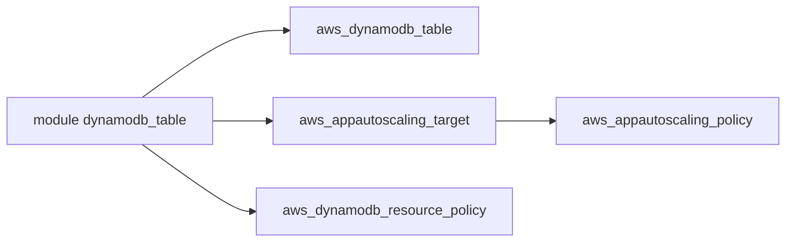

# terraform-aws-modules/terraform-aws-dynamodb-table

> Module Terraform pour créer une table DynamoDB avec autoscaling, index, réplicas et sauvegardes.

## Le problème
Déclarer une table DynamoDB complète (index, capacité, TTL, chiffrement, PITR) en code propre et reproductible.

## Ce que ça fait vraiment
Crée la table et, selon les options, politiques d'autoscaling, index secondaires, flux, réplicas globaux, import depuis S3, restauration. Facturation PAY_PER_REQUEST par défaut. Des avertissements décrivent les recréations de table si on bascule l'autoscaling ou `ignore_changes_global_secondary_index`.

## Comment c'est branché


## Essayer
```bash
# module "dynamodb_table" { source = "terraform-aws-modules/dynamodb-table/aws"
#   name = "my-table"  hash_key = "id" ... }
terraform state mv module.dynamodb_table.aws_dynamodb_table.this module.dynamodb_table.aws_dynamodb_table.autoscaled
```

## Coût et pièges
Table DynamoDB facturée par AWS. Provider aws >= 6.28 et Terraform >= 1.5.7. Le README contient une promotion du service compliance.tf, signalée comme écrite par le mainteneur qui le construit.

## Ce que ce n'est pas
Pas un outil qui contourne les limites du `lifecycle` de Terraform. Le service compliance.tf est une offre tierce avec compte à créer.

## Alternatives
Aucune alternative nommée dans le README.

## Pour toi
Surveiller : solide pour tes tables de features ou de métadonnées sur AWS, en ignorant l'encart promotionnel.

