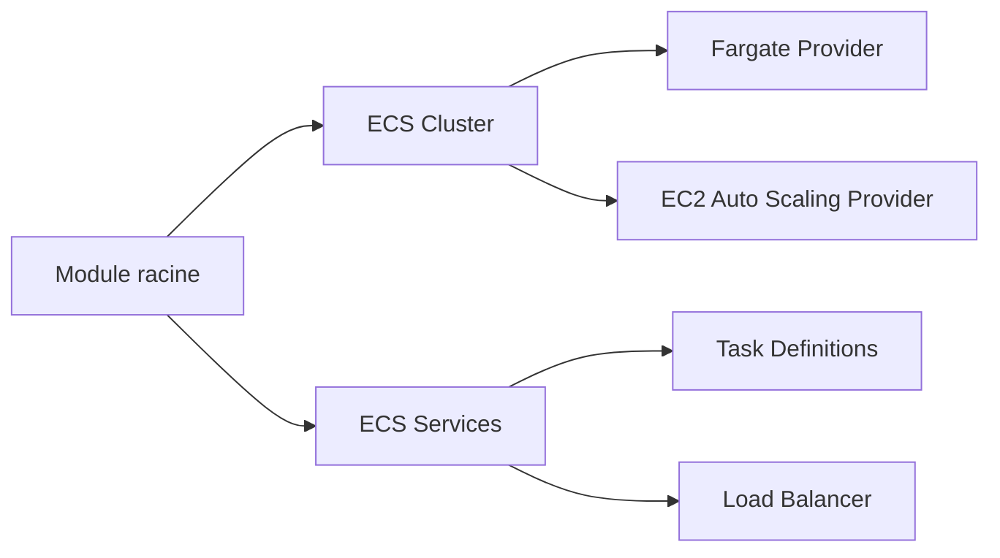

# terraform-aws-modules/terraform-aws-ecs

> Terraform module that creates an ECS cluster with Fargate or EC2 and its services on AWS.

## The problem
Describing the ECS cluster, services, task definitions, IAM roles and logs by hand is slow and repetitive.

## What it actually does
An integrated module creates the cluster and services in one go, or you can use the `cluster` and `service` submodules separately. It handles capacity providers (Fargate, Fargate Spot, EC2 Auto Scaling groups, managed instances), container definitions, Service Connect, load balancers, autoscaling and IAM roles. Wrappers exist for Terragrunt.

## How it is wired


## Trying it
```hcl
module "ecs" {
  source = "terraform-aws-modules/ecs/aws"
  cluster_name = "ecs-integrated"
  # voir le README pour services, capacity providers, etc.
}
```
Then the usual Terraform commands (not detailed in the README).

## Cost and gotchas
Free, but the AWS resources are billed. Terraform may revert the task definition deployed by a pipeline: the README suggests `ignore_task_definition_changes = true`. Requirements: Terraform 1.5.7 or later and AWS provider 6.41 or later.

## What it is not
Not a continuous deployment tool. The README also promotes compliance.tf, a service from the maintainer.

## Alternatives
The README names no alternative.

## For you
Keep an eye on it: handy for serving models in containers on AWS without Kubernetes, but keep it in reserve until you have that need.
