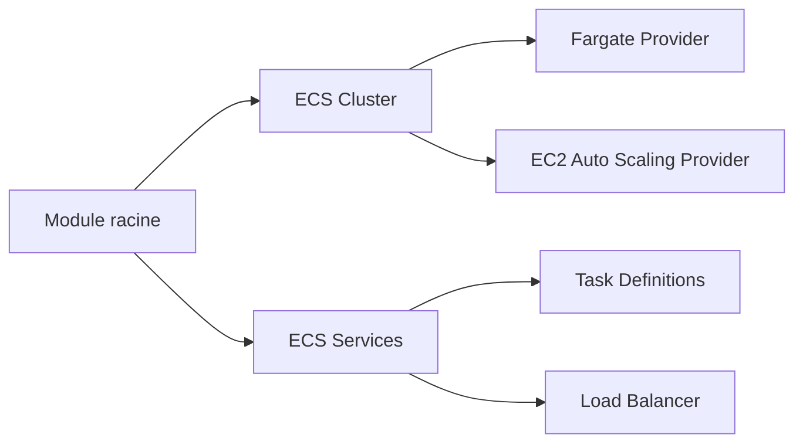

# terraform-aws-modules/terraform-aws-ecs

> Module Terraform qui crée un cluster ECS avec Fargate ou EC2 et ses services sur AWS.

## Le problème
Décrire cluster, services, définitions de tâches, rôles IAM et logs ECS à la main est long et répétitif.

## Ce que ça fait vraiment
Un module intégré crée cluster et services en une fois, ou bien on utilise séparément les sous-modules `cluster` et `service`. Il gère les fournisseurs de capacité (Fargate, Fargate Spot, groupes Auto Scaling EC2, instances managées), les définitions de conteneurs, Service Connect, les load balancers, l'autoscaling et les rôles IAM. Des wrappers existent pour Terragrunt.

## Comment c'est branché


## Essayer
```hcl
module "ecs" {
  source = "terraform-aws-modules/ecs/aws"
  cluster_name = "ecs-integrated"
  # voir le README pour services, capacity providers, etc.
}
```
Puis les commandes Terraform habituelles (non détaillées dans le README).

## Coût et pièges
Gratuit, mais les ressources AWS sont facturées. Terraform peut revenir sur la définition de tâche déployée par un pipeline : le README propose `ignore_task_definition_changes = true`. Prérequis : Terraform 1.5.7 ou plus et provider AWS 6.41 ou plus.

## Ce que ce n'est pas
Pas un outil de déploiement continu. Le README promeut aussi compliance.tf, un service du mainteneur.

## Alternatives
Le README ne nomme pas d'alternative.

## Pour toi
Surveiller : pratique pour servir des modèles en conteneurs sur AWS sans Kubernetes, mais à garder en réserve tant que tu n'as pas ce besoin.

