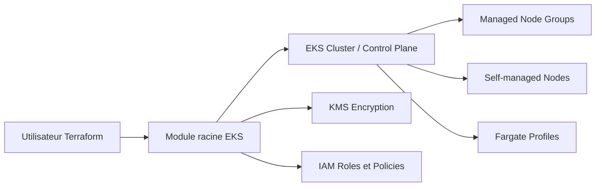

# terraform-aws-modules/terraform-aws-eks

> Terraform module that creates an EKS Kubernetes cluster on AWS, for anyone managing their infrastructure as code.

## The problem
Setting up an EKS cluster by hand means chaining IAM, security groups, KMS, logs, OIDC and node groups, with no reproducibility reference point.

## What it actually does
A root module drives the control plane (`aws_eks_cluster`), KMS encryption, CloudWatch, OIDC for IRSA and access entries. Three submodules cover managed node groups, self-managed ones and Fargate profiles. EKS Auto Mode, Karpenter and hybrid nodes each have an example. Inputs are very detailed maps of objects.

## How it is wired


## Trying it
```bash
# Extrait du README : bloc module
# source  = "terraform-aws-modules/eks/aws"
# version = "~> 21.0"
# Puis, côté utilisateur (commandes Terraform standard, non détaillées dans le README) :
terraform init
terraform apply
```

## Cost and gotchas
The module is free, but the AWS resources it creates are billed. To disable EKS Auto Mode, you must explicitly set `compute_config = { enabled = false }` before removing the block. The v17 to v21 upgrade guides show breaking changes between major versions.

## What it is not
Not EKS or Kubernetes documentation: the README points to AWS and Kubernetes for that. Changing `desired_size` of a node group has no effect on the Terraform side (documented limitation). The README also promotes compliance.tf, a service of the maintainer.

## Alternatives
- Karpenter (example provided in the repo): to drive the data plane rather than fixed node groups.
- EKS Auto Mode (example provided): to delegate node management to AWS.

## For you
Worth watching: a solid reference if your MLOps runs on EKS, but only dig into it the day you need it, because the effort goes into AWS configuration, not into data or AI.
