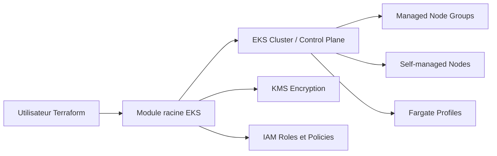

# terraform-aws-modules/terraform-aws-eks

> Module Terraform qui crée un cluster Kubernetes EKS sur AWS, pour qui gère son infra en code.

## Le problème
Monter un cluster EKS à la main, c'est enchaîner IAM, groupes de sécurité, KMS, logs, OIDC et groupes de nœuds, sans repère de reproductibilité.

## Ce que ça fait vraiment
Un module racine pilote le plan de contrôle (`aws_eks_cluster`), le chiffrement KMS, CloudWatch, l'OIDC pour IRSA et les access entries. Trois sous-modules couvrent les groupes de nœuds managés, auto-gérés et les profils Fargate. Le mode EKS Auto Mode, Karpenter et les nœuds hybrides ont chacun un exemple. Les entrées sont des maps d'objets très détaillées.

## Comment c'est branché


## Essayer
```bash
# Extrait du README : bloc module
# source  = "terraform-aws-modules/eks/aws"
# version = "~> 21.0"
# Puis, côté utilisateur (commandes Terraform standard, non détaillées dans le README) :
terraform init
terraform apply
```

## Coût et pièges
Le module est gratuit, mais les ressources AWS créées sont facturées. Pour désactiver EKS Auto Mode, il faut mettre explicitement `compute_config = { enabled = false }` avant de retirer le bloc. Les guides de mise à jour v17 à v21 montrent des changements cassants entre versions majeures.

## Ce que ce n'est pas
Pas une documentation EKS ou Kubernetes : le README renvoie vers AWS et Kubernetes pour cela. Changer `desired_size` d'un groupe de nœuds est sans effet côté Terraform (limite documentée). Le README fait aussi la promotion de compliance.tf, un service du mainteneur.

## Alternatives
- Karpenter (exemple fourni dans le dépôt) : pour piloter le plan de données plutôt que des groupes de nœuds fixes.
- EKS Auto Mode (exemple fourni) : pour déléguer la gestion des nœuds à AWS.

## Pour toi
Surveiller : référence solide si ton MLOps tourne sur EKS, mais à ne creuser que le jour où tu en as besoin, car l'effort va dans la configuration AWS, pas dans la donnée ni l'IA.

