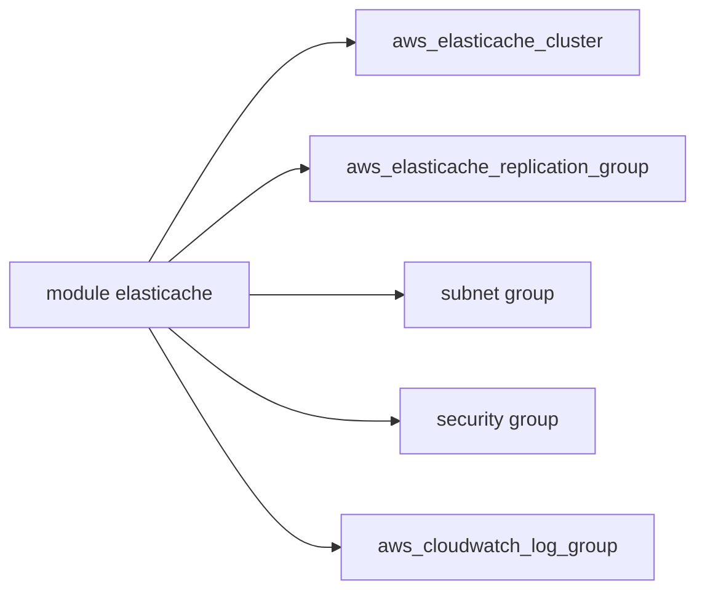

# terraform-aws-modules/terraform-aws-elasticache

> Terraform module to create AWS ElastiCache Redis, Valkey or Memcached clusters.

## The problem
An AWS managed cache requires a cluster, subnet group, parameter group, security and replication.

## What it actually does
Manages Memcached, Redis and Valkey clusters, replication groups (with cluster mode), primary/secondary global groups, and a serverless-cache submodule. Creates security group, subnets, parameter group, CloudWatch logs. Encryption at rest and in transit is enabled by default.

## How it is wired


## Trying it
```bash
# module "elasticache" { source = "terraform-aws-modules/elasticache/aws"
#   replication_group_id = "example-redis-replication-group" ... }
terraform init && terraform apply
```

## Cost and gotchas
ElastiCache nodes are billed by AWS. The example contains a hard-coded `auth_token` to replace. Providers aws >= 5.93.

## What it is not
Not a cache client: it neither reads from nor writes to the cache, it creates the ElastiCache infrastructure. It only works on AWS.

## Alternatives
No alternative named in the README.

## For you
Watch: handy for an inference or feature cache on AWS.
