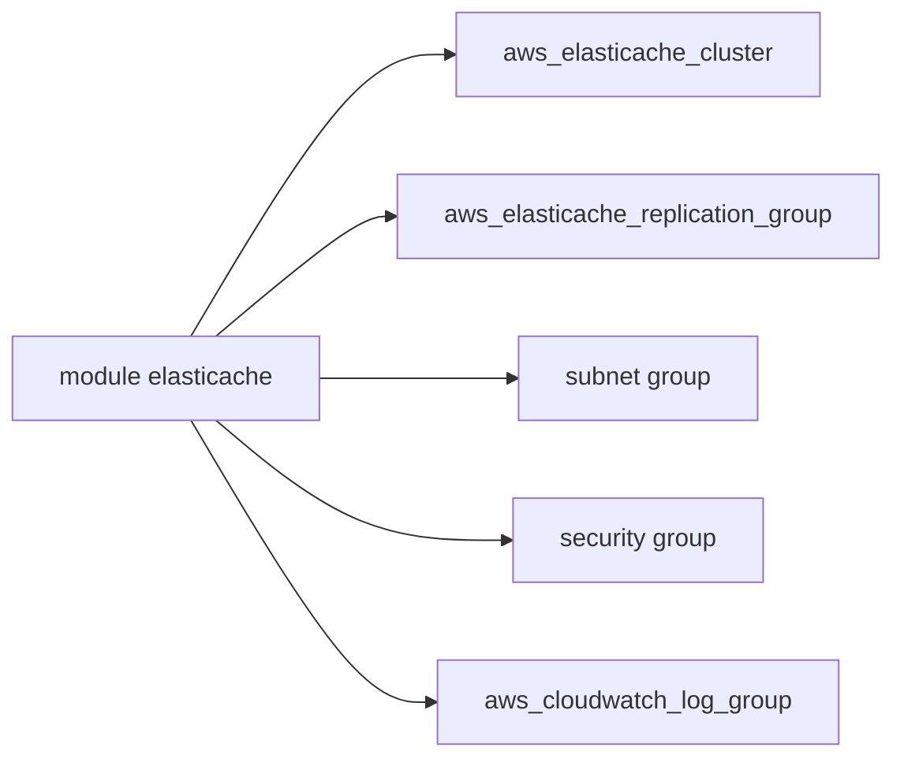

# terraform-aws-modules/terraform-aws-elasticache

> Module Terraform pour créer des clusters AWS ElastiCache Redis, Valkey ou Memcached.

## Le problème
Un cache géré AWS demande cluster, groupe de sous-réseaux, groupe de paramètres, sécurité et réplication.

## Ce que ça fait vraiment
Gère clusters Memcached, Redis, Valkey, groupes de réplication (avec mode cluster), groupes globaux primaire/secondaire, et un sous-module serverless-cache. Crée groupe de sécurité, sous-réseaux, groupe de paramètres, logs CloudWatch. Chiffrement au repos et en transit activés par défaut.

## Comment c'est branché


## Essayer
```bash
# module "elasticache" { source = "terraform-aws-modules/elasticache/aws"
#   replication_group_id = "example-redis-replication-group" ... }
terraform init && terraform apply
```

## Coût et pièges
Nœuds ElastiCache facturés par AWS. L'exemple contient un `auth_token` en dur à remplacer. Providers aws >= 5.93.

## Ce que ce n'est pas
Pas un client de cache. Seulement AWS.

## Alternatives
Aucune alternative nommée dans le README.

## Pour toi
Surveiller : pratique pour un cache d'inférence ou de features sur AWS.

