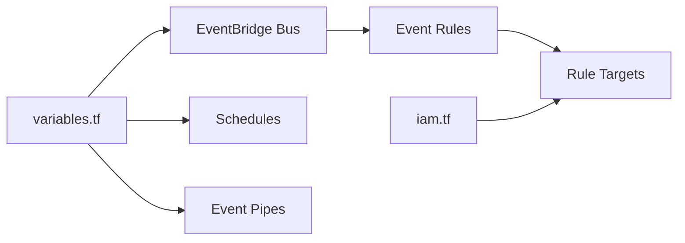

# terraform-aws-modules/terraform-aws-eventbridge

> Terraform module for AWS EventBridge buses, rules, targets, schedulers and pipes.

## The problem
EventBridge requires writing buses, rules, targets, IAM roles and logs separately, with a lot of repetition.

## What it actually does
A single `module` entry creates or reuses a bus, its rules and targets (SQS, Kinesis, Lambda, Step Functions, CloudWatch), archives, permissions, connections and API destinations, schedulers, pipes, log delivery, plus the necessary IAM roles. `create_*` and `attach_*` flags enable each piece.

## How it is wired


## Trying it
```hcl
module "eventbridge" {
  source = "terraform-aws-modules/eventbridge/aws"
  bus_name = "my-bus"
  rules = {
    orders = { event_pattern = jsonencode({ "source" : ["myapp.orders"] }) }
  }
}
```

## Cost and gotchas
AWS bill per event. Terraform >= 1.5.7, aws >= 6.28. The API Destination example shows a `client_secret` in plain text: do not copy it.

## What it is not
Not an application event framework: it is declarative infrastructure. The license is present but not identified by GitHub, to be checked.

## Alternatives
None cited in the README.

## For you
Worth watching: handy for triggering data pipelines on AWS events, but check the license before adoption.
