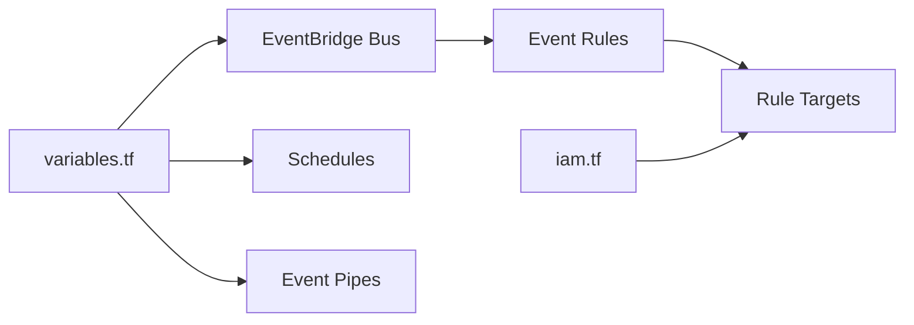

# terraform-aws-modules/terraform-aws-eventbridge

> Module Terraform pour bus, règles, cibles, schedulers et pipes AWS EventBridge.

## Le problème
EventBridge impose d'écrire séparément bus, règles, cibles, rôles IAM et logs, avec beaucoup de répétition.

## Ce que ça fait vraiment
Une seule entrée `module` crée ou réutilise un bus, ses règles et cibles (SQS, Kinesis, Lambda, Step Functions, CloudWatch), archives, permissions, connexions et destinations d'API, schedulers, pipes, livraison de logs, plus les rôles IAM nécessaires. Des drapeaux `create_*` et `attach_*` activent chaque morceau.

## Comment c'est branché


## Essayer
```hcl
module "eventbridge" {
  source = "terraform-aws-modules/eventbridge/aws"
  bus_name = "my-bus"
  rules = {
    orders = { event_pattern = jsonencode({ "source" : ["myapp.orders"] }) }
  }
}
```

## Coût et pièges
Facture AWS à l'événement. Terraform >= 1.5.7, aws >= 6.28. L'exemple API Destination montre un `client_secret` en clair : à ne pas copier.

## Ce que ce n'est pas
Pas un framework d'événements applicatif : c'est de l'infrastructure déclarative. La licence est présente mais non identifiée par GitHub, à vérifier.

## Alternatives
Aucune citée dans le README.

## Pour toi
Surveiller : pratique pour déclencher des pipelines de données sur événement AWS, mais vérifie la licence avant adoption.

