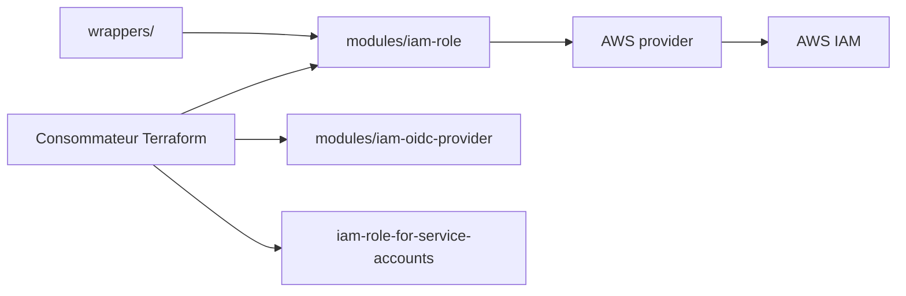

# terraform-aws-modules/terraform-aws-iam

> Collection of Terraform modules for AWS IAM resources: roles, users, groups, policies and federation.

## The problem
Writing trust policies, IRSA roles and OIDC providers for AWS by hand is slow and prone to security mistakes.

## What it actually does
Submodules: account (alias, password policy), group, user, policy, read-only policy, OIDC provider, role (AWS trust, GitHub OIDC, SAML, instance profile) and role for EKS service accounts (IRSA) with ready-made add-on policies. Wrappers allow creating several instances. Migrations preserve the Terraform state.

## How it is wired


## Trying it
```hcl
module "iam_role" {
  source = "terraform-aws-modules/iam/aws//modules/iam-role"
  name   = "example"
}
```
Reduced example taken from the README; no shell command is documented.

## Cost and gotchas
IAM is free at AWS. The trust inputs (OIDC URL, subjects, principals) are security-critical. The README recommends EKS Pod Identity instead of IRSA and contains an advertisement for the maintainer's compliance.tf.

## What it is not
Not an IAM audit tool. Terraform does not allow certain dynamic `lifecycle` settings (limitation flagged).

## Alternatives
- EKS Pod Identity module: suggested to replace IRSA (cited).

## For you
Adopt if you deploy on AWS with Terraform: well-made GitHub OIDC and IRSA roles avoid long-lived keys for your ML pipelines.
