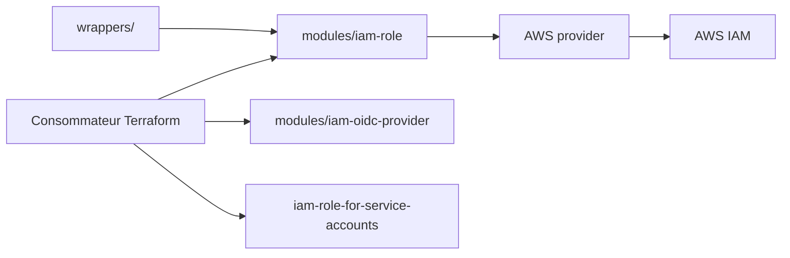

# terraform-aws-modules/terraform-aws-iam

> Collection de modules Terraform pour les ressources AWS IAM : rôles, utilisateurs, groupes, politiques et fédération.

## Le problème
Écrire à la main les politiques de confiance, rôles IRSA et fournisseurs OIDC pour AWS est long et source d'erreurs de sécurité.

## Ce que ça fait vraiment
Sous-modules : compte (alias, politique de mots de passe), groupe, utilisateur, politique, politique en lecture seule, fournisseur OIDC, rôle (confiance AWS, GitHub OIDC, SAML, profil d'instance) et rôle pour comptes de service EKS (IRSA) avec politiques d'add-ons prêtes. Des wrappers permettent de créer plusieurs instances. Des migrations préservent l'état Terraform.

## Comment c'est branché


## Essayer
```hcl
module "iam_role" {
  source = "terraform-aws-modules/iam/aws//modules/iam-role"
  name   = "example"
}
```
Exemple réduit tiré du README ; aucune commande shell n'est documentée.

## Coût et pièges
IAM est gratuit chez AWS. Les entrées de confiance (URL OIDC, sujets, principaux) sont critiques pour la sécurité. Le README recommande EKS Pod Identity à la place d'IRSA et contient une publicité pour compliance.tf du mainteneur.

## Ce que ce n'est pas
Pas un outil d'audit IAM. Terraform ne permet pas certains `lifecycle` dynamiques (limite signalée).

## Alternatives
- Module EKS Pod Identity : suggéré pour remplacer IRSA (cité).

## Pour toi
À adopter si tu déploies sur AWS avec Terraform : rôles OIDC GitHub et IRSA bien faits évitent des clés longues pour tes pipelines ML.

