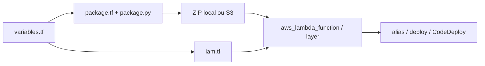

# terraform-aws-modules/terraform-aws-lambda

> Terraform module that builds, packages and deploys AWS Lambda functions and layers.

## The problem
Deploying a Lambda with its dependencies, IAM, aliases and triggers takes many Terraform resources and manual packaging.

## What it actually does
A `package.py` computes a content hash, installs dependencies (pip, poetry, npm, commands, Docker) and creates the zip only when needed. The module creates the function or layer, IAM role and policies, CloudWatch logs, trigger permissions, event source mappings, function URL, concurrency. Alias, deploy (CodeDeploy) and docker-build submodules. Supports local zip, S3 or ECR image.

## How it is wired


## Trying it
```bash
export TF_LAMBDA_PACKAGE_LOG_LEVEL=DEBUG2
terraform apply
sam local invoke --hook-name terraform module.hello_world_function.aws_lambda_function.this[0]
sam sync --hook-name terraform --watch
```

## Cost and gotchas
Lambda, S3 and CloudWatch are billed by AWS. Python 3.6+ required on the workstation (absent from Terraform Cloud workers by default). Concurrent archives from the same source get corrupted without `hash_extra`. The README contains an advertisement for compliance.tf, a product of the maintainer.

## What it is not
Not an application serverless framework: an infrastructure module. Some requests (dynamic `lifecycle`) are out of Terraform's reach.

## Alternatives
- AWS SAM CLI: mentioned for local testing, complementary.

## For you
Adopt it to deploy inference endpoints or light tasks on Lambda as IaC; a single main maintainer, but widely used and up to date.
